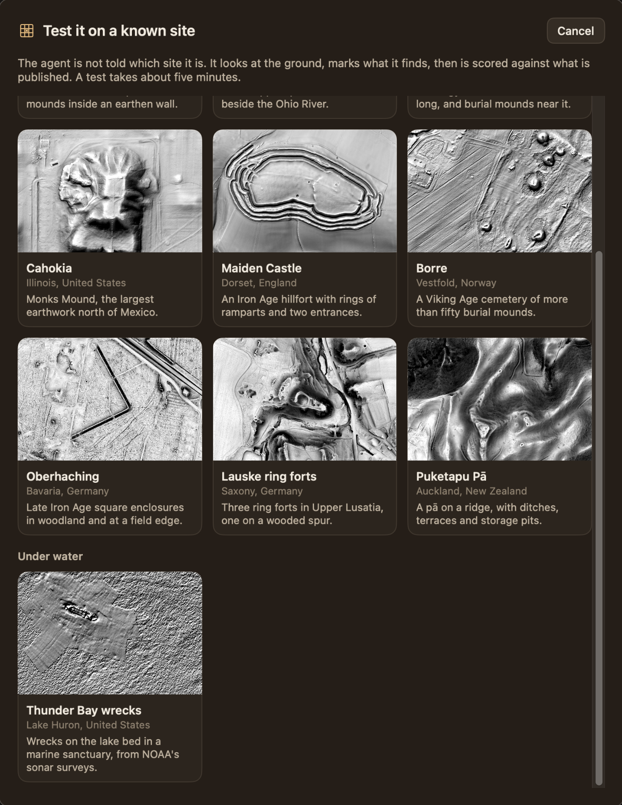
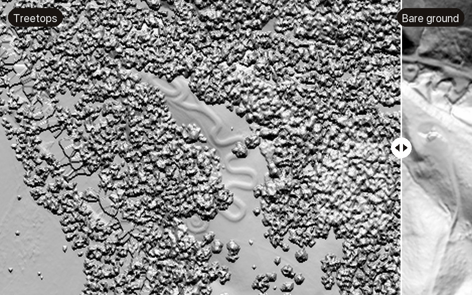
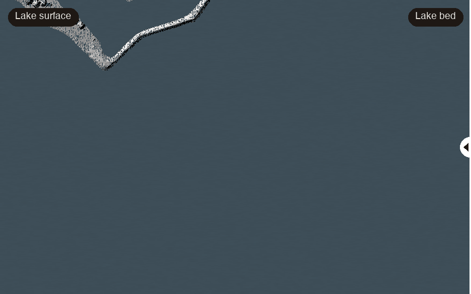
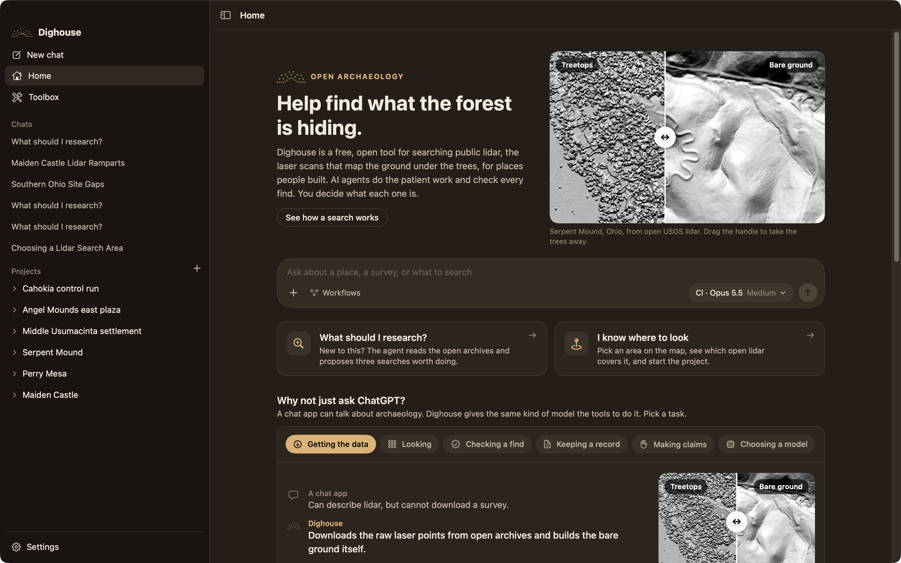

  

<h1 align="center">Dighouse</h1>

  <strong>Search public lidar for possible built features, check each one, and record what is already published.</strong> 
  You decide what they are.

  
  
  

  <a href="#get-started"><b>Get started</b></a> ·
  <a href="#benchmarks">Benchmarks</a> ·
  <a href="#how-a-search-works">How a search works</a> ·
  <a href="#the-tools">Tools</a> ·
  <a href="#open-data">Open data</a> ·
  <a href="#responsible-use">Responsible use</a> ·
  <a href="docs/ROADMAP.md">Roadmap</a>

A search at Angel Mounds, Indiana, from open USGS lidar: 9 tiles looked at, 5 finds marked, each one sliced, given a second model's opinion and searched in the literature.

Lidar is a laser scan from an aircraft that maps the ground through gaps in the trees, and a great deal of it is public. Most of it has never been searched for archaeology. Dighouse gives an AI model the tools to fetch that data, take the trees away, look over every square of ground, and check each thing it marks, then hands the decision to a person.

A **find** in Dighouse is a shape that might be built and is not yet confirmed. Most finds on open lidar turn out to be published already, and a record that says so is a result too.

## What it cannot do

- **It does not confirm sites.** A find is a reason to look, not a discovery. Confirming one takes an archaeologist, and often fieldwork. So far no find from a search has gone past "worth a closer look".
- **It misses things.** In the blind tests below it found large earthworks reliably and missed most small, low mounds: 29 of 53 at Borre, and 4 of the 11 low megalithic mounds in Navarre's 2 m model.
- **Under water it is a pilot.** It reads NOAA's sonar surveys of US waters only. A wreck lying flat, buried in sediment, among rocks, or in a gap between survey lines will not show.
- **It cannot read everything published.** Many papers are behind paywalls, and official site registers in most countries are not public, so "no match in the sources read" often means little was readable.
- **It sees shapes in the ground, not artefacts.** Lidar cannot show buried deposits, pottery scatters, or a feature's date or culture.
- **It needs a Mac and some setup.** It builds from source on an Apple silicon Mac today; the tools also run on their own in any harness that speaks the Model Context Protocol.

## Benchmarks

Each test is **blind**: the agent is not told the site, looks at every tile, marks what it finds, and is scored against an answer key of published features before it may read any literature. Try one yourself from Home with **Test it on a known site**.

| Site | Data | Found of known | Missed | Not in the key |
|---|---|---|---|---|
| Mound City Group, Ohio * | USGS 3DEP | 19 of 19 | 0 | 14 (real mounds the key leaves out, and measured rises) |
| Angel Mounds, Indiana | USGS 3DEP | 4 of 4 | 0 | 3 |
| Cahokia, Monks Mound, Illinois * | USGS 3DEP | 1 of 1 | 0 | 8 |
| Serpent Mound, Ohio | USGS 3DEP | 1 of 3 (the effigy) | 2 burial mounds | 2 |
| Maiden Castle, England * | Environment Agency 1 m | 3 of 3 | 0 | 33 |
| Borre, Norway * | Kartverket 1 m | 29 of 53 | 24 small burial mounds | 10 |
| Oberhaching square enclosures, Bavaria | Bavarian DGM1 1 m | 2 of 3 | 1 enclosure | 3 |
| Lauske ring forts, Saxony | Saxon DGM1 1 m | 3 of 3 | 0 | 5 |
| Irulegi hill, Navarre | Navarre 2 m | 1 of 2 (the castle) | the Iron Age village | 0 |
| Sierra de Andía megaliths, Navarre * | Navarre 2 m | 4 of 11 | 7 low mounds and dolmens | 114 |
| Puketapu Pa, Auckland | LINZ 1 m | 1 of 1 | 0 | 8 |
| Munoaundi hillfort, Basque Country | Basque 1 m | 0 of 1 | the rampart (marked 141 m off its mapped line) | 1 |
| Arrola hillfort, Basque Country | Basque 1 m | 0 of 1 | the rampart (banks marked 97 m outside the mapped outline) | 1 |
| **All thirteen on land** | | **67 of 105** | 38 | 202 |
| Thunder Bay wrecks, Lake Huron (three areas) | NOAA sonar, 1 m | 4 of 7 charted wrecks | 3 | 5 |

<table>
  <tr>
    <td width="50%"> <b>A blind test's scorecard.</b> The agent was not told it was Angel Mounds. Each published mound is circled; each green dot is a find.</td>
    <td width="50%"> <b>What is this?</b> Type a place and get the ground in two views and what is on record nearby, in about a minute, without making a project.</td>
  </tr>
</table>

 <b>Ten sites to test it on.</b> Mounds, hillforts, ring forts and a pā on land, and a wreck on the lake bed from NOAA's sonar surveys. Press one and the agent searches it blind.

\* Rerun on 2026-11-22, when a whole search also opens the measured rises that stand out most from the ground around them, on every tile looked at (at most 40 per km²): recall rose at Borre (21 to 29 of 53 over two loops), Maiden Castle (1 to 3) and Andía (0 to 4), and so did the finds a person rules out; Mound City and Andía went a little over 50 per km² of them. Andía's extras leave out 72 marked by a mound-only pass that was tried in the same run and not kept. The rest were run on 2026-11-16 with primary / 6.1 Terra, a low-cost model, at medium effort, about 3 to 10 minutes a site. Every land site was run with the same method (the two Basque hillforts a day later): a look at the whole area first, then every tile, then a slice and a map check for each find. The answer keys come from official registers (Norway, Navarre, the Bavarian monument office, Auckland Council), from NOAA's charts for the wrecks, and from OpenStreetMap features with the publications that describe them (the rest). Most keys are partial, so a find "not in the key" can be a real feature. Every site, run, miss and fix is in [TEST_LOOP.md](docs/TEST_LOOP.md#log) and [WORLD_LOOP.md](docs/WORLD_LOOP.md#log). Results will differ with other models.

The underwater row is a pilot: one source (NOAA's sonar surveys of US waters and the Great Lakes), three small areas of Thunder Bay National Marine Sanctuary, and one scored run each. The three charted wrecks it missed stand barely above a rocky lake bed, or lie at the edge of the survey.

Small mounds are the weak spot: a mound 5 m across is a few pixels in a tile picture. `find_mounds` measures round rises in the ground model instead, and the clearest ones (at least 0.6 m high and nearly round) go on a list for a person to look over, apart from the agent's finds. On the six original sites that list puts 50 of 83 known features in front of a person instead of 45, for 28 more spots to rule out. It does not travel well: on rough ground it floods the list, with 565 spots on the Navarre upland (where it reaches 6 of the 11 megaliths) and 54 at the Saxon forts.

A whole search now also opens the measured rises that stand out most from the ground around them, on every tile looked at, as finds marked "measured, not seen", at most 40 per km² (`add_measured_rises`). On rough ground the old ranking, by height and roundness, picked rocks; the new one looks at the rise against the roughness around it and at two window sizes. Scored on saved blind runs, that took Borre from 21 to 25 of 53 mounds and Maiden Castle from 1 to 3 of 3, with fewer than 50 extra finds per km² everywhere.

The second opinion takes about a second a find: the app sends the model the ground 120 m around each find, a few at a time, as soon as each area is done. It is a filter, not a confirmation. Rated blind on 102 crops of known ground, Claude Sonnet 5.5 called 19 of 24 published features built, and when it said "not built" it was right 91% of the time; when it said "built" it was right only 40% of the time. Each record says so: a second opinion that disagrees counts, one that agrees is a weak check.

> [!NOTE]
> Dighouse builds from source today. The app is signed for local use and is not yet notarized. The archaeology tools also run on their own in Codex or any harness that speaks the Model Context Protocol.

## Why it exists

In November 2026 Pietro Miotti let AI agents search about 1,200 km² of NASA lidar overnight, and they marked a Maya site. It turned out to be already published. Finding things was cheap; checking them was the part that failed.

Dighouse is built around the check. Every find gets a slice through the raw laser points, a second opinion from a different model, a look at open maps for roads and buildings, and a search of what is published. Hollows, cuts and straight edges are also looked up on old maps: USGS sheets and mine records in the United States, the État-major map and 1950s aerial photographs in France. The tools refuse a status the evidence does not support, and nothing is ever called new.

A chat app can talk about archaeology. It cannot download a survey, look at every tile of an area, cut a slice through the points, or keep a record that someone else can pick up. Dighouse gives the same kind of model those abilities, with rules that hold whichever model is running.

We checked. Given the Mound City blind test box with no tools, the same model that found 19 of 19 mounds there through Dighouse answered that it could not reliably identify, count or place any features from the coordinates alone. That is the right answer for a chat app, and the reason the tools exist.

*A dig house is the building where an excavation team lives, works and keeps its records. The app plays the same role for a search.*

## How a search works

  

Serpent Mound, Ohio, from open USGS lidar. Dighouse keeps only the laser returns that reached the ground.

  

Thunder Bay, Lake Huron. The shore and breakwater come from airborne lidar, which stops at the water; the lake bed and its two wrecks come from NOAA's sonar surveys.

1. **Choose where to look.** Ask "What should I research?" and the agent weighs open lidar, how little is on record, and where earthworks survive, then proposes three searches. Or press **Pick a place on the map** on Home, where the places with open data are shaded, and click where you want to look. Or type a place and press **What is this?** for a one-minute look.
2. **Calibrate.** Before searching where nothing is on record, the agent runs a blind test on the nearest known site with the same kind of lidar. If it finds less than half of what is published there, the search stops.
3. **Take the trees away.** The tools download the raw laser points, or a national ground model, and keep the ground.
4. **Look at every tile.** The ground is cut into squares called tiles, and agents look at each one in two renderings. A feature guide tells it what mounds, banks and terraces look like, and what to rule out (sinkholes, tree throws, craters, tracks). A tile with too little ground data is marked unreadable, never "nothing found".
5. **Check every find.** A slice straight down through the laser points shows whether a shape is in the ground or only in the treetops. A second, different model gives its own opinion without seeing the first. Open maps are checked for roads, buildings and sites already mapped.
6. **Search what is published.** The agent searches books, papers and site records, opens what it can, and logs every source as read, could not open, or not relevant.
7. **Keep the record, and you decide.** Every find is a Markdown page with its pictures, measurements, checks and sources. You decide what it is, and your name and reason go into the record.

Take the stages one at a time, or press **Find and report back** and the agent carries the search to its end, then returns a report of at most 400 words with your decisions listed first.

## A look at the app

<table>
  <tr>
    <td width="50%"> <b>Home.</b> Four ways in, and known sites ready to fetch right below them.</td>
    <td width="50%"> <b>New project.</b> The shaded areas have open lidar. Click to zoom in, click again to place the area, and see which surveys cover it.</td>
  </tr>
  <tr>
    <td width="50%"> <b>A project.</b> Maiden Castle from England's 1 m ground model. The card at the top says what the agent does next, why, and what follows.</td>
    <td width="50%"> <b>A record.</b> Each find with its relief, its slice and every check.</td>
  </tr>
  <tr>
    <td width="50%"> <b>Toolbox.</b> One real search at Cahokia in six stages, each a picture to press or drag. Here a line across Monks Mound draws its slice.</td>
    <td width="50%"> <b>Open data.</b> Where each kind of data reaches, from the United States to New Zealand, and a page for every service the tools read. OpenStreetMap was partly online when this was taken.</td>
  </tr>
  <tr>
    <td width="50%"> <b>Workflows.</b> Who does each part of a search, and where the open project stands.</td>
    <td width="50%"> <b>How it runs.</b> You, the model, the engine and the tools, each with its state now.</td>
  </tr>
</table>

**Search on its own** from Home: choose how long, and the agent picks fresh ground with open lidar, searches it area by area (about 15 minutes for each square km on USGS lidar), checks every find, and asks a second model about each when the time is up.

**Decide** is where a person makes the calls. **Needs you** shows the leads, then the finds where the agent and the second model disagree, one at a time: a close view 60 m across, the whole tile, the slice, and one line saying what each model thinks. Return agrees with the suggestion; a letter picks another decision and asks for your reason. **Agree in bulk** shows the routine finds as a grid of close views; untick any that look wrong and agree with the rest in one press. **Done** lists what you decided, with Undo. Your name and a reason go on every record.

**Also in the app:** a ten-minute first project at Serpent Mound, a chat with `/` commands, `@` mentions and ⌘K, any model through the [OpenCodex](https://github.com/lidge-jun/opencodex) router (so a different maker's model can give the second opinion), three colour looks and five text sizes.

## Get started

You need a Mac with Apple silicon and macOS 14 or later, a ChatGPT account, and Xcode (free from the App Store). In Terminal:

~~~sh
git clone https://github.com/chrissotraidis/dighouse.git
cd dighouse
./scripts/setup.sh
~~~

The script checks for Codex, your sign-in and uv, offers to install what is missing, then builds and opens Dighouse. [docs/SETUP.md](docs/SETUP.md) walks through the first launch, where projects and chats are kept, and what to do if something goes wrong. Dighouse keeps its chats to itself, so they do not appear in the Codex app.

**Use the tools without the app.** They are a Model Context Protocol server:

~~~sh
cd dighouse
uv sync
codex mcp add dighouse -- uv run --directory "$PWD" dighouse-tools
~~~

Then start a chat in an empty folder and ask the agent to follow [skills/dighouse/SKILL.md](skills/dighouse/SKILL.md).

**Tests.**

~~~sh
uv run pytest            # offline, on a synthetic survey (37 tests)
uv run python scripts/smoke_test.py   # one tile end to end against the real services, about a minute
uv run pytest -m live    # the same chain against the real data services (10 tests)
~~~

## The tools

| Stage | Tools |
|---|---|
| Choose where to look | `find_place`, `open_surveys`, `survey_area`, `find_gaps`, `open_resources`, `search_records` |
| Set up | `init_project` |
| Fetch open lidar, or use your own | `find_data`, `fetch_terrain`, `import_terrain` |
| Draw the bare ground | `view_terrain`, `make_tiles`, `render_tiles`, `next_tiles`, `view_tile` |
| Look at every tile | `record_verdict`, `flag_candidate`, `find_mounds`, `add_measured_rises` |
| Check each find | `check_finds`, `cut_section`, `second_look`, `check_modern`, `check_old_maps`, `record_old_maps`, `add_control` |
| Test the method on a known site | `list_tests`, `start_test`, `score_test`, `calibration_site`, `start_calibration`, `record_calibration` |
| A quick look at one place | `quick_look` |
| Know what to look for | `feature_guide` |
| Search what is published | `search_literature`, `read_source`, `log_source` |
| Records and runs | `add_evidence`, `suggest_decision`, `set_status`, `list_candidates`, `run_status`, `write_summary`, `write_report`, `document_project`, `export_finds` |

The ground is drawn as `composite`, `hillshade`, `local_relief` and `sky_view`. Tool names keep the project's older words (candidate, section, second look). `export_finds` writes GeoJSON for QGIS, ArcGIS or Google Earth, under `private/` because it holds coordinates.

## Open data

Everything Dighouse reads is public. Only Denmark's ground model needs a free token.

| Service | What Dighouse reads |
|---|---|
| [OpenTopography](https://portal.opentopography.org/datasets) | The catalog of lidar surveys, including ones flown for archaeology, and their raw points |
| [USGS 3DEP](https://registry.opendata.aws/usgs-lidar/) | Raw lidar points for most of the United States |
| [Environment Agency](https://environment.data.gov.uk/survey) | England's 1 m ground model |
| [AHN](https://www.ahn.nl/) | The Netherlands' 0.5 m ground model |
| [IGN LiDAR HD](https://geoservices.ign.fr/lidarhd) | France's 0.5 m ground model |
| [Digitaal Vlaanderen](https://www.vlaanderen.be/digitaal-vlaanderen) | Flanders' 1 m ground model |
| [Kartverket](https://hoydedata.no) | Norway's 1 m ground model |
| [Estonian Land Board](https://geoportaal.maaamet.ee/eng/Spatial-Data/Elevation-data-p308.html) | Estonia's 1 m ground model |
| [swisstopo](https://www.swisstopo.admin.ch/en/height-model-swissalti3d) | Switzerland's 0.5 m ground model |
| [IDENA](https://idena.navarra.es) | Navarre's 2 m ground model, from the Government of Navarre |
| [geoEuskadi](https://www.geo.euskadi.eus) | The Basque Country's 1 m ground model, from the Basque Government |
| [Bavarian Surveying Administration](https://geodaten.bayern.de/opengeodata/OpenDataDetail.html?pn=dgm1) | Bavaria's 1 m ground model |
| [GeoSN](https://www.geodaten.sachsen.de/downloadbereich-digitale-hoehenmodelle-4851.html) | Saxony's 1 m ground model |
| [ČÚZK](https://geoportal.cuzk.cz) | Czechia's 2 m ground model (DMR 5G) |
| [Geobasis NRW](https://www.bezreg-koeln.nrw.de/geobasis-nrw) | North Rhine-Westphalia's 1 m ground model |
| [Scottish Remote Sensing Portal](https://remotesensingdata.gov.scot) | Scotland's open lidar, 0.5 to 1 m, where flown |
| [DataMapWales](https://datamap.gov.wales/maps/lidar-viewer/) | Wales' 1 m ground model |
| [ARSO](https://gis.arso.gov.si/evode/profile.aspx?id=atlas_voda_Lidar@Arso) | Slovenia's 1 m ground model |
| [Toitū Te Whenua LINZ](https://registry.opendata.aws/nz-elevation/) | New Zealand's 1 m ground model, where it has been flown |
| [Dataforsyningen](https://dataforsyningen.dk/data/930) | Denmark's 0.4 m ground model, an option for anyone who pastes a free Dataforsyningen token in Settings |
| [Natural Resources Canada](https://open.canada.ca/data/en/dataset/0fe65119-e96e-4a57-8bfe-9d9245fba06b) | Canada's 1 m ground model (HRDEM), mostly from lidar, where it has been flown |
| [VIRTUAL SHIZUOKA](https://github.com/aigidjp/opendata_virtualshizuoka) | Shizuoka Prefecture's 0.5 m ground model, Japan |
| [INFOMAR](https://www.infomar.ie) | Sonar surveys of the seabed around Ireland, as an about 4 m depth model |
| [NOAA NCEI](https://www.ncei.noaa.gov/products/nos-hydrographic-survey) | Sonar surveys of the seafloor in US waters and the Great Lakes, as 1 m depth grids |
| [NOAA charts](https://encdirect.noaa.gov) | Charted cables, pipelines and dumping grounds near a find under water |
| [USGS historical topographic maps](https://www.usgs.gov/programs/national-geospatial-program/historical-topographic-maps-preserving-past) | Old map sheets (about 1890 to 1990) under a find in the United States: buildings, ponds, quarries and roads at the time |
| [USGS Mineral Resources Data System](https://mrdata.usgs.gov/mrds/) | Recorded mines and prospects near a find in the United States |
| [IGN Géoplateforme](https://geoservices.ign.fr) | The État-major map (1820 to 1866) and aerial photographs of 1950 to 1965 under a find in France |
| [Fund og Fortidsminder](https://www.kulturarv.dk/fundogfortidsminder/) | Denmark's national register of ancient monuments, for checking a find |
| [IDENA heritage layer](https://idena.navarra.es) | Navarre's register of protected archaeological sites, for checking a find |
| [OpenStreetMap](https://www.openstreetmap.org/) | Mapped sites through [QLever](https://qlever.dev/); roads and buildings near a find through Overpass, or OpenStreetMap's own map service when Overpass is down |
| [Wikidata](https://www.wikidata.org/) | Archaeological sites already on record |
| [Pleiades](https://pleiades.stoa.org/) | About 35,000 located ancient places |
| [National Register of Historic Places](https://www.nps.gov/subjects/nationalregister/) | Historic places in the United States |
| [Open Context](https://opencontext.org/) | Published excavation and survey records |
| [OpenAlex](https://openalex.org/) and [Crossref](https://www.crossref.org/) | The literature search. Without a key, OpenAlex allows about 100 searches a day for each network address, and Crossref takes over past that |

Historic aerial photographs, declassified CORONA imagery, and the lidar of Finland and Sweden need an account or a key (Sweden's 1 m model has been free since February 2025, with a free account), so the tools do not read them yet. Spain beyond Navarre and the Basque Country, Poland and Luxembourg were tried and are not read yet; the Open data tab says why for each.

## Rules the tools enforce

These live in the tools, so they hold whichever model is running.

- A tile with too little ground data is marked unreadable and cannot be given a verdict.
- A find cannot be marked as in the ground without a slice that shows it there.
- The second opinion must come from a different model than the one that marked the find.
- A find cannot be marked as having no match in what is published until a slice, a second opinion, a map check and at least one read source are on its record, and a named person makes that call.
- Nothing is ever called new. A record says how many sources were read and that none matched.
- Locations are stored only under `private/`. Records, notes and run summaries carry no coordinates, because published coordinates invite looting.

## Responsible use

- **Do not visit or dig.** A find is a desk result. Digging or metal-detecting on a site destroys what it holds, and in many places it is illegal without a permit.
- **Report, do not post.** Send a find to the heritage authority (in the United States, the state historic preservation office; in England, the local Historic Environment Record), not to social media. Published locations invite looting.
- **Think of the people connected to a place.** Many sites, including the mound sites in the tests above, matter to descendant communities. Consult them before anything is made public.
- **Leave wrecks alone.** Many wrecks are war graves or protected by law, and many hold the remains of those who sailed them. Report a wreck find to NOAA's Office of National Marine Sanctuaries or the state's underwater archaeology program, never online.
- **Keep locations private.** Dighouse keeps coordinates under `private/`. Export for mapping software writes a GeoJSON file there too; that file holds locations, so treat it as you would the site itself.

## A project is a folder

~~~
my-project/
  RESEARCH.md     the research record: everything looked at, read and decided, and what is left
  PROJECT.md      the question, why this area, the rules, and how the project is kept
  METHODOLOGY.md  how the search and the record are kept, and lessons learned here
  candidates/     one Markdown record per find, with its pictures
  notes/          a dated log, run summaries, how the project started, and record.json (what was looked at, without locations)
  sources/        what was read, what could not be opened, and pages you saved
  reports/        the search report, and drafts for the heritage authority
  data/           downloaded points, ground models, tiles (not versioned)
  private/        locations, exports and run state (not versioned)
~~~

Markdown is the record of truth, so a project works offline and can be handed to an archaeologist like any folder. Each project keeps its own git history without `data/` or `private/`. Dighouse rebuilds `RESEARCH.md` whenever a run ends, a person decides or the project is opened, and the agent reads it before it starts, so work adds up instead of starting over. A section of `PROJECT.md`, "How this project is kept", says which file holds what, so an agent in plain Codex can carry a project on without Dighouse.

**Where projects go.** Every new project is a new folder in `~/Dighouse`, with its own repository and a first commit. If you keep your work in `~/GitHub`, choose "Work out of my GitHub folder" on New project, or say so in a chat, and the project goes in `~/GitHub/<name>` instead. Dighouse never picks that on its own, never writes into a repository that is already there (a taken name gets a number), and refuses folders kept in iCloud.

**From a chat to a project.** Talk a place through in a chat. Once the agent has a place and a question, it offers a card, Make this a project (or type `/make-project`). Pressing it opens New project already filled in. The chat moves into the project, and what it settled (the question, why this area, what it read and what it ruled out) becomes the project's first records, committed as "Started from chat".

**History and publishing.** A project's overview lists its latest changes, with Show in Finder and Publish to GitHub (or `/publish`). Publishing first checks that `private/` and `data/` stay out and that no shared file holds a coordinate. Then it asks you, and makes a private repository on your account with GitHub's `gh` tool. Later runs go up with Push changes. Nothing is ever made public or sent on its own.

**Handing a project over.** File › Export Project makes a zip without `data/` or `private/`, so it holds no locations. The other person opens the folder, the record shows every tile and what it showed as earlier work, and one button, Carry on, picks up what is left.

## Status and limits

The [eight-hour research session and replays](docs/2026-11-20-research-session.md) record where the coordinator intervened, why Cahokia's ranking changed, and what still needs a full-session test. Earlier app tests are documented in [TEST_LOOP.md](docs/TEST_LOOP.md), [REFINE_LOOP.md](docs/REFINE_LOOP.md), [POLISH_LOOP.md](docs/POLISH_LOOP.md), [USABILITY_LOOP.md](docs/USABILITY_LOOP.md), [NEXT_LOOP.md](docs/NEXT_LOOP.md) and [GOAL_LOOP.md](docs/GOAL_LOOP.md).

- There is no notarized download yet.
- A vision model's eye is the weak point of any search; the benchmarks above show where it is weak. The checks exist because a model marks shapes that are not there, and misses some that are.
- Open services go down and rate-limit. The tools say "could not check" rather than guess.

What comes next is in the [roadmap](docs/ROADMAP.md), and the next loop of work, on deciding finds, is planned in [DECIDE_LOOP.md](docs/DECIDE_LOOP.md). The concept is in [concept.md](docs/concept.md), the design rules in [DESIGN.md](docs/DESIGN.md), and the state of the work in [HANDOFF.md](docs/HANDOFF.md).

## Contributing

Issues and pull requests are welcome; [CONTRIBUTING.md](CONTRIBUTING.md) explains how. The tools are plain Python in `src/dighouse` with offline tests; the app is SwiftUI in `app/Sources/Dighouse`. A new national ground model is a good first contribution: copy the closest entry in `national.py`. Please keep the rules above intact, and never put coordinates of a find in an issue. Security problems and leaked locations go through [SECURITY.md](SECURITY.md).

**Only people are credited.** Contributors may use AI tools, but no AI is listed as an author or co-author of a commit or pull request; a check enforces it. The policy for people and agents is in [AGENTS.md](AGENTS.md).

**AI disclosure.** Dighouse was built with substantial AI assistance for code, tests, documentation and debugging. There is no audited share of AI-written code; the run logs state what was checked and how.

## Acknowledgements

Dighouse stands on open data published by the agencies and projects in the table above, on the [Codex](https://github.com/openai/codex) engine, and on [OpenCodex](https://github.com/lidge-jun/opencodex) for model routing. Lidar is read with [laspy](https://laspy.readthedocs.io/) and [rasterio](https://rasterio.readthedocs.io/).

## Licence

Apache 2.0, matching the Codex engine.
