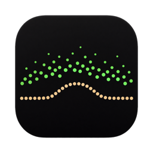
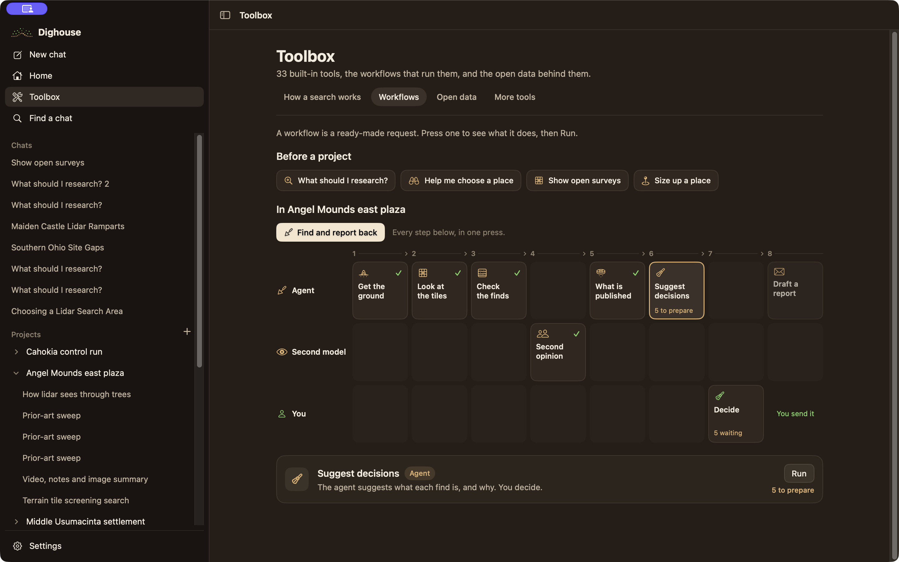
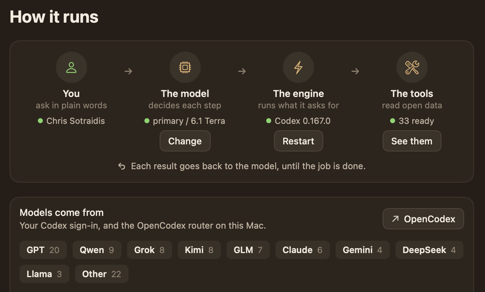

  

<h1 align="center">Dighouse</h1>

  <strong>Open archaeology on your Mac.</strong> 
  AI agents search public lidar for places people built, check every find, and keep a record an archaeologist can trust. You make the calls.

  
  
  
  
  
  
  
  
  
  
  

  <a href="#build-and-run"><b>Build and run</b></a> ·
  <a href="#how-a-search-works">How a search works</a> ·
  <a href="#the-tools">The tools</a> ·
  <a href="#open-data">Open data</a> ·
  <a href="#the-rules-the-tools-enforce">Rules</a> ·
  <a href="#status">Status</a>

A search at Angel Mounds, Indiana, from open USGS lidar. The agent looked at 9 tiles, marked 5 finds, cut a slice through each, got a second model's opinion and searched what is published. The overview says what happens next in plain words, and the research record keeps everything looked at and read.

**AI disclosure:** Dighouse uses substantial AI assistance for code, tests, documentation, debugging and maintenance. There is no audited percentage of AI-generated code; the [run logs](docs/REFINE_LOOP.md#log) state what has actually been checked and how.

> [!IMPORTANT]
> **Dighouse is not a download yet.** You build it from source on your own Mac. The build is signed for local use only and is not notarized. The tools work today, in the app or in any harness that speaks the Model Context Protocol.

## Why

In November 2026 Pietro Miotti let AI agents search about 1,200 km² of NASA lidar overnight, and they marked a Maya site. It turned out to be already published. Finding things was cheap; checking them was the part that failed.

Dighouse is built around the check. Every find gets a slice through the raw laser points, a second opinion from a different model, a look at open maps for roads and buildings, and a search of what is published. The tools refuse a status the evidence does not support, and nothing is ever called new. A person makes the last call.

A dig house is the building where an excavation team lives, works and keeps its records. The app plays the same role for a search.

## How a search works

  

Serpent Mound, Ohio, from open USGS lidar. Lidar sees through the gaps in the trees; Dighouse keeps only the ground returns.

1. **Choose where to look.** Ask "What should I research?" and the agent compares open lidar with what is already on record and proposes three searches. Or pick an area on a map and see which open lidar covers it.
2. **Bare ground.** The tools download the raw laser points (or a national ground model), keep the ones that reached the ground, and draw the bare ground in four views.
3. **Look.** The ground is cut into squares called tiles and agents look at every one, in two views. A tile with too little ground data is marked unreadable, never "nothing found".
4. **Check.** Each find gets a slice, which is a cut straight down through the laser points that shows whether the shape is in the ground or only in the treetops. It also gets a second opinion from a different model, and a look at open maps for roads, buildings and sites already mapped.
5. **Read.** The agent searches books, papers and Open Context, opens what it can, and logs every source as read, could not open, or not relevant. Pages that refuse a program can be opened by you in the Sources tab and handed to the agent.
6. **Record.** Every find is a Markdown page with its pictures, measurements, checks and sources. You decide what it is, and your name and reason go into the record.

You can take the stages one at a time, or press **Find and report back** and get all of them in one go, ending with a report of 400 words at most.

## The app

`app/` holds Dighouse for macOS: a native SwiftUI app that runs the [Codex](https://github.com/openai/codex) engine with the archaeology tools attached. If the [OpenCodex](https://github.com/lidge-jun/opencodex) router is running, every model in its roster appears in the model menu, so a different maker's model can give the second opinion.

<table>
  <tr>
    <td width="50%"> <b>Home.</b> Drag between the treetops and the bare ground, type a place to search it in one press, or take one of two ways in.</td>
    <td width="50%"> <b>New project.</b> Place the search area on the map and see which open lidar covers it before you start.</td>
  </tr>
  <tr>
    <td width="50%"> <b>A project.</b> Maiden Castle from the Environment Agency's 1 m ground model: 42 tiles looked at and five finds on the ramparts and entrances. The card at the top says what the agent will do next, why, and what follows.</td>
    <td width="50%"> <b>Records.</b> Each find with its relief, its slice and every check. The decision is yours.</td>
  </tr>
  <tr>
    <td width="50%"> <b>Toolbox.</b> One real search at Cahokia in six stages, each a picture to press or drag. Here a line dragged across Monks Mound draws its slice.</td>
    <td width="50%"> <b>Open data.</b> Where each kind of data reaches, and a tile for every service the tools read. Press one for a picture made from its data and something to try.</td>
  </tr>
  <tr>
    <td width="50%"> <b>Workflows.</b> Who does each part of a search, where the open project stands, and a Run button for each.</td>
    <td width="50%"> <b>How it runs.</b> The model, the engine and the tools, each with its state now and the one thing to do about it.</td>
  </tr>
</table>

- **A first project in ten minutes.** "Start your first project" on Home is a tutorial at Serpent Mound: six steps, one sentence each, with the control to press ringed. Leave it and it resumes at the same step.
- **Find and report back.** Type a place on Home and press one button, or press it on a project's overview, or type /investigate. The agent runs the whole search as a goal, Dighouse asks a second model about each find, and a report opens with the decisions that wait for you first. The top bar shows the stage it is on and a Stop.
- **A project that guides.** The overview says what the agent will do next, why, and what follows, in words that need no archaeology. The main button carries the search to its end; one step alone is the smaller button. When finds wait for you it says "Your turn".
- **One word for one thing.** A shape the agent marked is a find. A cut through the laser points is a slice. The agent looks at tiles, and another model gives a second opinion. The app, the records and the reports all use these words.
- **Chat** works with or without a project. It shows the agent's plan, each step it takes, helper agents, and long runs folded into one line. One button opens the model list, with recent models first and the thinking effort above it, named and described as the model list has it. The message box takes images, video, audio and other files.
- **Like Codex:** type / for commands (/investigate, /look, /check, /review, /undo, /fork, /compact, /goal and more) and @ to point at a find, tile, source or file. ⌘K jumps to any project, chat, find, page or command. When something fails, the chat says what happened and offers Try again or another model.
- **A workspace beside the chat:** the map of tiles and finds (four views, and a line you draw to cut a slice), the records, the notes, the sources with a browser to open them, and the project's data. The review goes through the finds one at a time, with the agent's suggested decision filled in.
- **The Toolbox** has four tabs: one real search to step through, the workflows as a picture of who does what, the open data on a map with a page for each service, and other tools the agent can use.
- **Its own look.** Six drawings made in SwiftUI (a trowel, a brush, a sieve, soil layers, a mound and a survey grid) mark the stages, the workflows and the places with nothing in them yet. While the agent works, a trowel scrapes along a line of soil; it holds still with Reduce Motion. Three colour looks; Earth is the default.
- **Settings** is seven short pages: your name and folders, the look, the two models, how it runs, every tool in a searchable list, what data goes where, and the versions.

## Build and run

You need an Apple silicon Mac with macOS 14 or later, [Codex](https://github.com/openai/codex) signed in, and [uv](https://docs.astral.sh/uv/). Dighouse uses the newest copy of Codex it finds on the Mac, including the one inside the Codex app, because providers refuse their newer models to an older engine. It was last checked with 0.167; with 0.146 the model list loads but GPT-6.1 Terra is refused.

~~~sh
git clone https://github.com/chrissotraidis/dighouse.git
cd dighouse/app
./scripts/bundle.sh          # builds app/build/Dighouse.app
open build/Dighouse.app
~~~

The first launch walks through setup and builds the tools' Python environment by itself, which takes about a minute.

### Use the tools without the app

The tools are a Model Context Protocol server, so they also work in Codex or any other harness that speaks MCP.

~~~sh
cd dighouse
uv sync
codex mcp add dighouse -- uv run --directory "$PWD" dighouse-tools
~~~

Then start a chat in an empty folder and ask the agent to follow [skills/dighouse/SKILL.md](skills/dighouse/SKILL.md).

### Tests

~~~sh
uv run pytest            # offline, on a synthetic survey (13 tests)
uv run pytest -m live    # the same chain against the real data services (8 tests)
~~~

## The tools

| Stage | Tools |
|---|---|
| Choose where to look | `find_place`, `open_surveys`, `survey_area`, `find_gaps`, `open_resources`, `search_records` |
| Set up | `init_project` |
| Find and fetch open lidar, or use your own | `find_data`, `fetch_terrain`, `import_terrain` |
| Look at the bare ground | `view_terrain`, `make_tiles`, `render_tiles`, `next_tiles`, `view_tile` |
| Look at every tile | `record_verdict`, `flag_candidate` |
| Check each find | `cut_section`, `second_look`, `check_modern`, `add_control` |
| Search what is published | `search_literature`, `read_source`, `log_source` |
| Records and run | `add_evidence`, `suggest_decision`, `set_status`, `list_candidates`, `run_status`, `write_summary`, `write_report`, `document_project`, `export_finds` |

The ground is drawn in four views: `composite`, `hillshade`, `local_relief` and `sky_view`. Tool names keep the project's older words (candidate, section, second look); the app and the records say find, slice and second opinion. `export_finds` writes the finds as GeoJSON for QGIS, ArcGIS or Google Earth, under `private/` because it holds coordinates.

## Open data

Everything Dighouse searches is public, and none of it needs an account or a key.

| Service | What Dighouse reads |
|---|---|
| [OpenTopography](https://portal.opentopography.org/datasets) | The catalog of lidar surveys, including ones flown for archaeology, and their raw points |
| [USGS 3DEP](https://registry.opendata.aws/usgs-lidar/) | Raw lidar points for most of the United States |
| [Environment Agency](https://environment.data.gov.uk/survey) | England's 1 m lidar ground model |
| [AHN](https://www.ahn.nl/) | The Netherlands' 0.5 m ground model |
| [IGN LiDAR HD](https://geoservices.ign.fr/lidarhd) | France's 0.5 m ground model |
| [Digitaal Vlaanderen](https://www.vlaanderen.be/digitaal-vlaanderen) | Flanders' 1 m ground model |
| [Kartverket](https://hoydedata.no) | Norway's 1 m ground model |
| [Estonian Land Board](https://geoportaal.maaamet.ee/eng/Spatial-Data/Elevation-data-p308.html) | Estonia's 1 m ground model |
| [swisstopo](https://www.swisstopo.admin.ch/en/height-model-swissalti3d) | Switzerland's 0.5 m ground model |
| [OpenStreetMap](https://www.openstreetmap.org/) | Mapped sites through [QLever](https://qlever.dev/); roads and buildings near a find through Overpass, or OpenStreetMap's own map service when Overpass is down |
| [Wikidata](https://www.wikidata.org/) | Archaeological sites already on record |
| [Pleiades](https://pleiades.stoa.org/) | About 35,000 located ancient places |
| [National Register of Historic Places](https://www.nps.gov/subjects/nationalregister/) | Historic places in the United States |
| [Open Context](https://opencontext.org/) | Published excavation and survey records |
| [OpenAlex](https://openalex.org/) | The literature search. Without a key it allows about 100 searches a day for each network address |
| [Crossref](https://www.crossref.org/) | The literature search, when OpenAlex turns a request away |

Historic aerial photographs, declassified CORONA imagery, and the lidar of Denmark, Finland and Sweden need an account or a key, so the tools name them as out of reach. Scotland, Wales, Slovenia, Spain, Poland and Luxembourg were tried in November 2026 and are not read yet; the Open data tab says why for each.

## The rules the tools enforce

These are built into the tools, so they hold whichever model is running.

- A tile with too little ground data is marked unreadable and cannot be given a verdict.
- A find cannot be marked as in the ground without a slice that shows it there.
- The second opinion must come from a different model than the one that marked the find.
- A find cannot be marked as having no match in what is published until a slice, a second opinion, a map check and at least one read source are on its record, and a named person makes that call. Sources that could not be opened are written into the decision.
- Nothing is ever called new. A record says how many sources were read and that none matched.
- Locations are stored only under `private/` in the project folder. Records, notes and run summaries carry no coordinates, because published coordinates invite looting.

## A project is a folder

~~~
my-project/
  RESEARCH.md     the research record: everything looked at, read and decided, and what is left
  PROJECT.md      the question and the rules agents follow
  METHODOLOGY.md  how the search and the record are kept, and lessons learned here
  candidates/     one Markdown record per find, with its pictures
  notes/          a dated log the tools write as work happens, run summaries, and record.json (what was looked at, without locations)
  sources/        what was read, what could not be opened, and pages you saved
  reports/        the search report, and drafts for the heritage authority
  data/           downloaded points, ground models, tiles (not versioned)
  private/        locations, exports and run state (not versioned)
~~~

Markdown is the record of truth, so a project works offline and can be shared or handed to an archaeologist like any folder. Each project keeps its own git history, which leaves out data/ and private/.

Every project documents itself the same way, so work adds up. Dighouse rebuilds RESEARCH.md from the project's files whenever a run ends, a person decides or the project is opened. It opens with a few plain lines for a newcomer (what the project asks, how far it got, a link to each find, and how to continue), then lists:

- the data used, and every tile looked at with its verdict (including the ones that showed nothing);
- every find's checks and decision;
- every source read or not opened, and every literature search;
- what is still to do.

The agent reads it before it starts, says what is already done, and builds on it.

**Handing a project over.** File › Export Project makes a zip without data/ or private/, so it holds no locations. The other person unzips it and opens the folder with File › Open Project Folder. The record still lists every tile and what it showed, marked as earlier work, and the overview offers one button, Carry on. The agent does not fetch or look at that ground again unless asked.

## Checked against known sites

Finding a known site again is the right answer for a test.

- **Cahokia, Illinois.** The control run measured Monks Mound at 27.6 m high in its slice, with 79 ground returns within 5 m of its peak, and the map check found the paths and stairs on it.
- **Angel Mounds, Indiana.** A run marked five mounds. The largest, C-001, matches the published description of Mound A in the sources the agent read, and a second model agreed it looks built.
- **Maiden Castle, England.** From the Environment Agency's ground model, the agent described the four lines of rampart and both entrances.
- **Mound City Group, Ohio.** A run counted 22 mounds inside the enclosure from the lidar; the thesis it read gives 24, and it matched the hollows outside the wall to the published borrow pits.
- **Serpent Mound, Ohio.** One press of Find and report back looked at 9 tiles, marked the effigy, the conical mound south of it and a pair of curved lines, read three sources, and suggested that the first two are already published (Squier and Davis 1848; Schwarz 2020), in about eight minutes. The decisions were left to a person.
- **Borre, Norway.** From Kartverket's 1 m ground model, one press of Find and report back looked at 9 tiles, marked the large burial mounds, read the county's page on Borrehaugene and suggested they are already published, in about six minutes.
- **Perry Mesa, Arizona.** Proposed by "What should I research?", it built into 66 readable tiles at 4 ground returns per square metre.

## Status

Working: everything in the tables above, and the macOS app as shown. The run logs say what was checked in the running app and what was not: the newest is [docs/REFINE_LOOP.md](docs/REFINE_LOOP.md), and [docs/POLISH_LOOP.md](docs/POLISH_LOOP.md), [docs/USABILITY_LOOP.md](docs/USABILITY_LOOP.md), [docs/NEXT_LOOP.md](docs/NEXT_LOOP.md) and [docs/GOAL_LOOP.md](docs/GOAL_LOOP.md) came before it.

Not built yet: the agent driving a browser of its own, looking at tiles in bulk through the model router, a button that pushes records to Notion, a notarized download, and slices that show treetops for datasets published as ground points only. The design is in [docs/concept.md](docs/concept.md), the state of the work is in [docs/HANDOFF.md](docs/HANDOFF.md), and a study of whether the same method could search open sky data is in [docs/research/open-astronomy.md](docs/research/open-astronomy.md).

## Licence

Apache 2.0, matching the Codex engine.

