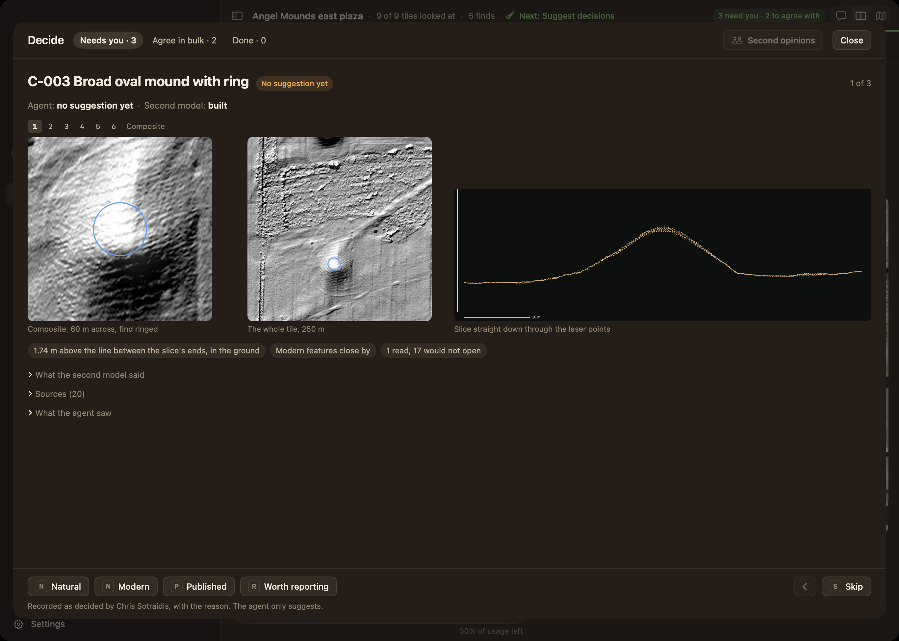
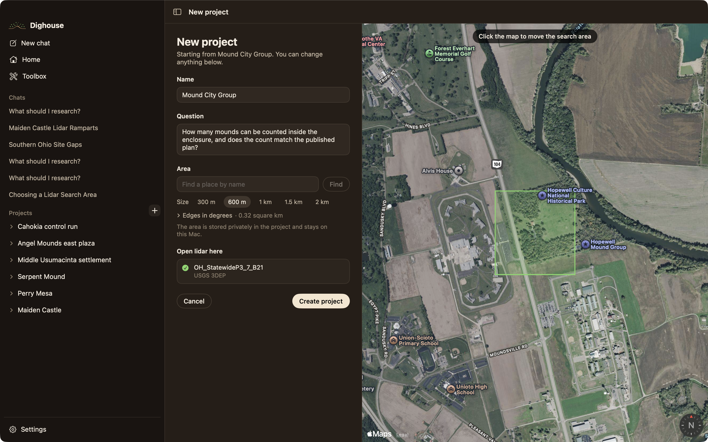
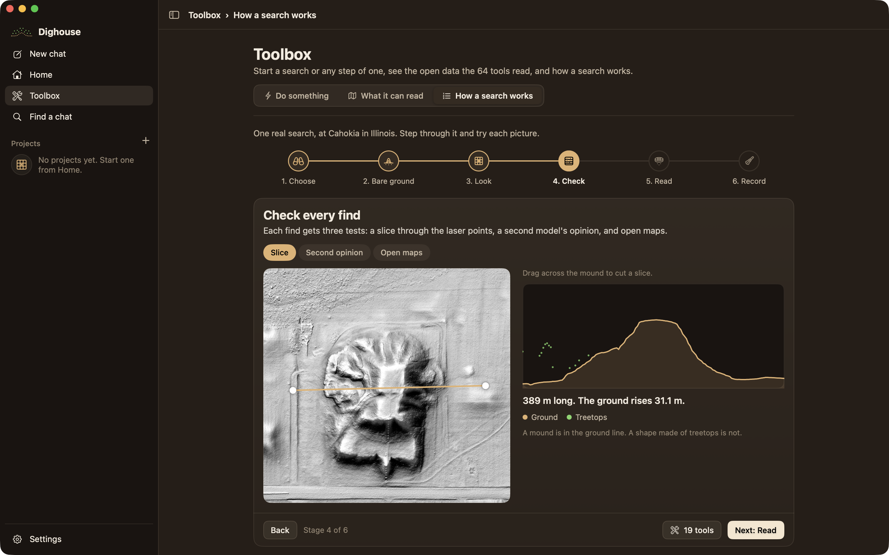

  

<h1 align="center">Dighouse</h1>

  <strong>Agentic open archaeology on your Mac.</strong> 
  Use AI agents to search public lidar for mounds, hillforts and other earthworks, check every find against open records, and decide what each one is.

  
  
  
  
  
  
  
  

  <a href="#download-and-set-up"><b>Download</b></a> ·
  <a href="#how-a-search-works">How a search works</a> ·
  <a href="#what-it-cannot-do">Limits</a> ·
  <a href="#benchmarks">Benchmarks</a> ·
  <a href="#questions-people-ask">Questions</a> ·
  <a href="#get-help-and-share-ideas">Help and Discord</a> ·
  <a href="#for-developers">Developers</a>

A search at Angel Mounds, Indiana, from open USGS lidar: 9 tiles looked at, 5 finds marked, each one sliced, given a second model's opinion and searched in the literature.

The United States, Canada, much of Europe and New Zealand have flown lidar over their land and published it free. Lidar is a laser scan from an aircraft that reaches the ground through gaps in the trees, and on that bare ground the mounds, banks, ditches and old fields people left behind can still show. There is far more of it than anyone can look over by eye.

Dighouse is a free, open-source Mac app that puts AI agents to work on it, on your own ChatGPT or Claude account. Pick a region, or let the agent choose one with open lidar and little on record. It downloads the ground, looks at every tile and marks what might be built. On a ready-made ground model it has looked over 65 km² of Ohio in an hour.

In November 2026 Pietro Miotti's agents searched about 1,200 km² of NASA lidar overnight and marked a Maya site that turned out to be already published. Dighouse is built for the checking that comes after the marking. A slice through the laser points shows whether a find is in the ground, and a different model gives its own opinion without seeing the first one's. Open maps, and the site register where one is open, show whether it is modern or already recorded, and the agent searches the published literature for the area. Finds arrive ranked, with the evidence for and against each. You decide what each one is, and for a find worth reporting Dighouse drafts the letter to the records office for you to send.

A **find** is a shape the agent marked that might be built. Most turn out to be modern, natural or already recorded, and a record that says which is a result too.

> [!NOTE]
> **This is an early release.** Searching thirteen known sites blind, it found 67 of 105 published features ([Benchmarks](#benchmarks)). It finds large earthworks reliably and misses many small, low mounds. So far no find from a search has gone past "worth a closer look". The quickest way to see what it does is to run it on a known site and check its work against what is published.

## Download and set up

You don't need a GitHub account, Terminal or any coding to use Dighouse.

**What you need**

- A Mac with Apple silicon (M1 or later) and macOS 14 Sonoma or later. Intel Macs are not supported yet.
- A ChatGPT account on a plan that includes Codex, or an OpenAI API key. Dighouse runs its AI through your account, so a search counts toward your plan's usage (or is billed to the key). The chat box shows how much you have left. [Which account does what](docs/GETTING_STARTED.md#which-account), and what was measured.
- Or a Claude plan with [Claude Code](https://docs.claude.com/en/docs/claude-code/setup). Claude Code then runs the search with Dighouse's tools, and you decide the finds in the app. With a ChatGPT account as well, Claude can give the second opinion on each find ([how](docs/SETUP.md#if-you-use-claude)).
- An internet connection. A search downloads a few megabytes of ground for each square kilometre.

**Install it**

1. Open the [latest release](https://github.com/chrissotraidis/dighouse/releases/latest). Under **Assets**, click the file whose name starts with `Dighouse-` and ends in `.dmg`.
2. Open the downloaded file and drag **Dighouse** into **Applications**.
3. Open Dighouse from Applications. It is signed and notarized by Apple, so macOS opens it like any app you download.

On the first launch a guide of three steps does the setting up. While you read the first, Dighouse puts OpenAI's Codex engine in its own folder and prepares the archaeology tools, in about a minute. Then you sign in with ChatGPT in your browser (Dighouse never sees your password), paste an OpenAI API key, or choose a Claude account through Claude Code. You pick a model that can read images and take a guided first search.

**Good first steps**, all on Home:

- **Start your first project.** Six steps at Serpent Mound, Ohio, in about ten minutes, from getting the ground to deciding what a find is.
- **Places to start.** One press sets up Cahokia, the Newark Great Circle, a ring fort in Saxony or a wreck in Lake Huron.
- **Test it blind.** The agent searches a famous site without being told which, then is scored against what is published.
- **What is this?** Type a place and see its ground in two views, and what is on record nearby, in about a minute.
- **Find something.** Choose how long (an hour is a good start). The agent picks a region with open lidar and little on record, searches it on its own, and brings back what needs your decision.

[docs/GETTING_STARTED.md](docs/GETTING_STARTED.md) covers the first hour in more detail: deciding, what to do if something looks real, what stays on your Mac, and fixes for when something goes wrong.

## How a search works

<table>
  <tr>
    <td width="50%"> <b>Serpent Mound, Ohio,</b> from open USGS lidar. Dighouse keeps only the laser returns that reached the ground.</td>
    <td width="50%"> <b>Thunder Bay, Lake Huron.</b> The shore comes from airborne lidar, which stops at the water. The lake bed and its two wrecks come from NOAA's sonar surveys.</td>
  </tr>
</table>

1. **Choose where to look.** Ask "What should I research?" and the agent proposes three searches, weighing open lidar, how little is on record and where earthworks survive. Or press **Pick a place on the map** on Home and click a gold area.
2. **Calibrate.** Before searching where nothing is on record, the agent runs a blind test on the nearest known site with the same kind of lidar. If it finds less than half of what is published there, the search stops. One test can vary by a few features, so the mark is judged over the last ten tests of that site on that lidar on your Mac.
3. **Take the trees away.** The tools download the raw laser points, or a national ground model, and keep the ground.
4. **Look at every tile.** The ground is cut into squares called tiles. A low-cost vision model looks at every tile in bulk, then the agent looks closely at the ones worth it, in two renderings. A feature guide tells both what mounds, banks and terraces look like, and what to rule out (sinkholes, tree throws, craters, tracks). Without the [OpenCodex](https://github.com/lidge-jun/opencodex) router the agent looks at every tile itself, which is slower.
5. **Check every find.** A slice straight down through the laser points shows whether a shape is in the ground or only in the treetops. A second, different model gives its own opinion without seeing the first. Open maps are checked for roads, buildings and sites already mapped. Hollows, cuts and straight edges are looked up on old maps too: USGS sheets and mine records in the United States, the État-major map and 1950s aerial photographs in France.
6. **Search what is published.** The agent searches books, papers and site records, opens what it can, and logs every source as read, could not open, or not relevant.
7. **You decide.** Every find is a Markdown page with its pictures, measurements, checks and sources. You decide what it is, and your name and reason go on the record.

Take the stages one at a time, or press **Find and report back** and the agent carries the search to its end, then returns a report of at most 400 words with your decisions listed first.

You can watch it work. On the project's map each tile lights up as it is looked at, in green where it looks built and amber where it might be, each find arrives with a pulse, and a small panel keeps the strongest leads so far at the top. Press a find for its slice, then **Look closely** for its close views, the old maps and the two flights beside it, or **3D**.

### Rules the tools enforce

These live in the tools, so they hold whichever model is running.

- A tile with too little ground data is marked unreadable and cannot be given a verdict.
- A find cannot be marked as in the ground without a slice that shows it there.
- The second opinion must come from a different model than the one that marked the find.
- A find cannot be marked as having no match in what is published until a slice, a second opinion, a map check and at least one read source are on its record, and a named person makes that call.
- Nothing is ever called new. A record says how many sources were read and that none matched.
- Locations are stored only under `private/`. Records, notes and run summaries carry no coordinates, because published coordinates invite looting.

## A look at the app

<table>
  <tr>
    <td width="50%"> <b>Home.</b> <b>Find something</b> sets the agent searching on its own, and known sites to try are one press away.</td>
    <td width="50%"> <b>Decide.</b> One find at a time: a close view, the whole tile and a slice through the laser points. A key records your decision and your reason.</td>
  </tr>
  <tr>
    <td width="50%"> <b>A record.</b> Each find with its relief, its slice and every check. Its location stays on your Mac.</td>
    <td width="50%"> <b>New project.</b> The gold areas have open lidar. Click to zoom in, click again to place the area, and see which surveys cover it.</td>
  </tr>
  <tr>
    <td width="50%"> <b>Toolbox.</b> One real search at Cahokia in six stages, each a picture to press or drag. Here a line across Monks Mound draws its slice.</td>
    <td width="50%"> <b>What is this?</b> Type a place and get the ground in two views and what is on record nearby, in about a minute, without making a project.</td>
  </tr>
</table>

**Projects.** A project holds its areas of ground, its finds and decisions, and its chats: the run that searched it, a chat that checks one lead, a chat that writes the report. Every chat in a project starts from its research record. In the sidebar, projects come first with their chats folded under them, then chats in no project, then the blind tests.

**Decide** is where a person makes the calls. What needs you waits on Home under **Waiting for you**, across every project.

- **Needs you** shows the leads, then the finds where the agent and the second model disagree, one at a time and in order of rank. Each comes with a close view 60 m across in nine styles on the keys 1 to 9, the whole tile, the slice with a 1.70 m figure for scale (press D to turn it), one line of measurements, and the checks sorted into **For** and **Against**. Return agrees with the suggestion. A letter picks another decision and asks for your reason.
- **The rank**, A, B or C, counts how many of three checks call a find built: the shape, the agent's eye and the second opinion. It never changes what needs you.
- **Compare two flights** works where two dated USGS flights cover a find in the United States. It slides the older over the newer and says whether the find was there in both, appeared between them (possibly modern) or went.
- **Old maps beside the ground** lays the oldest USGS sheets over the bare ground, or in France the État-major map and the 1950s photographs, with a divider to slide and a fade.
- **Turn it in 3D** turns the ground 120 m around a find, with heights ×1, ×2 or ×4, a light you can move, a person 1.70 m tall for scale and a ruler.
- **Mark a spot** on the Map makes anything you see into a find in your name, with its slice and checks. Drag a box instead and the agent looks closely at the tiles under it, up to 24.
- **Not sure what it is?** **Ask the agent about it** puts a question about the find in a new chat for you to send.
- **Agree in bulk** shows the routine finds as a grid. Untick any that look wrong and agree with the rest in one press. **Done** lists what you decided, with Undo.

**Settings** shows your ChatGPT and Claude accounts side by side, what Dighouse keeps on disk part by part with a way to clear it, and what leaves your Mac.

**Also in the app:** a chat with `/` commands, `@` mentions and ⌘K, any model through the [OpenCodex](https://github.com/lidge-jun/opencodex) router, and Claude through Claude Code (so a different maker's model can give the second opinion), three colour looks and five text sizes.

## What it cannot do

- **It does not confirm sites.** A find is a reason to look. Confirming one takes an archaeologist, and often fieldwork.
- **It misses things.** In the blind tests it found large earthworks reliably and missed many small, low mounds: 24 of 53 burial mounds at Borre, and 6 of the 11 megaliths in Navarre's 2 m model. A vision model's eye is the weak point of any search, and the checks exist because a model marks shapes that are not there.
- **Under water it is a pilot.** It reads NOAA's sonar surveys of US waters only. A wreck lying flat, buried in sediment, among rocks, or in a gap between survey lines will not show.
- **It cannot read everything published.** Many papers are behind paywalls, and official site registers in most countries are closed, so "no match in the sources read" often means little was readable. Dighouse reads the open registers of Denmark, Norway, Navarre and England's scheduled monuments. Every record names what it was checked against, and when, and each project says at the top whether its area has a register to check against.
- **It sees shapes in the ground.** Lidar cannot show buried deposits, pottery scatters, or a feature's date or culture.
- **Open services go down and rate-limit.** The tools then say "could not check" and never guess.
- **It needs an Apple silicon Mac and a ChatGPT plan with Codex, or an OpenAI API key.** With a Claude plan alone, the search runs from Claude Code and the app is where you decide the finds. There is no Windows, Linux or iPad version. The tools also run on their own in any harness that speaks the Model Context Protocol.

## Responsible use

- **Do not visit or dig.** A find is a desk result. Digging or metal-detecting on a site destroys what it holds, and in many places it is illegal without a permit.
- **Report to the heritage authority, never to social media.** In the United States that is the state historic preservation office, in England the local Historic Environment Record. Published locations invite looting.
- **Think of the people connected to a place.** Many sites, including the mound sites in the blind tests, matter to descendant communities. Consult them before anything is made public.
- **Leave wrecks alone.** Many wrecks are war graves or protected by law, and many hold the remains of those who sailed them. Report a wreck to NOAA's Office of National Marine Sanctuaries or the state's underwater archaeology program, never online.
- **Keep locations private.** Dighouse keeps coordinates under `private/`. Export for mapping software writes a GeoJSON file there too, so treat that file as you would the site itself.

## Benchmarks

Each test is **blind**. The agent is not told the site, looks at the ground tile by tile, marks what it finds, and is scored against an answer key of published features before it may read any literature. Try one yourself from Home with **Test it blind**.

| Site | Data | Found of known | Missed | Not in the key | Per km² |
|---|---|---|---|---|---|
| Mound City Group, Ohio * | USGS 3DEP | 19 of 19 | 0 | 17 (real mounds the key leaves out, and measured rises) | 68 |
| Angel Mounds, Indiana | USGS 3DEP | 4 of 4 | 0 | 3 | 8 |
| Cahokia, Monks Mound, Illinois * | USGS 3DEP | 1 of 1 | 0 | 12 | 48 |
| Serpent Mound, Ohio | USGS 3DEP | 1 of 3 (the effigy) | 2 burial mounds | 2 | 6 |
| Maiden Castle, England * | Environment Agency 1 m | 3 of 3 | 0 | 35 | 40 |
| Borre, Norway * | Kartverket 1 m | 29 of 53 | 24 small burial mounds | 11 | 29 |
| Oberhaching square enclosures, Bavaria | Bavarian DGM1 1 m | 2 of 3 | 1 enclosure | 3 | 2 |
| Lauske ring forts, Saxony | Saxon DGM1 1 m | 3 of 3 | 0 | 5 | 2 |
| Irulegi hill, Navarre | Navarre 2 m | 1 of 2 (the castle) | the Iron Age village | 0 | 0 |
| Sierra de Andía megaliths, Navarre * | Navarre 2 m | 5 of 11 | 6 low mounds and dolmens | 133 | 62 |
| Puketapu Pa, Auckland | LINZ 1 m | 1 of 1 | 0 | 8 | 16 |
| Munoaundi hillfort, Basque Country | Basque 1 m | 0 of 1 | the rampart (marked 141 m off its mapped line) | 1 | 4 |
| Arrola hillfort, Basque Country | Basque 1 m | 0 of 1 | the rampart (banks marked 97 m outside the mapped outline) | 1 | 5 |
| **All thirteen on land** | | **67 of 105** | 38 | 202 | 19 |
| Thunder Bay wrecks, Lake Huron (three areas) | NOAA sonar, 1 m | 4 of 7 charted wrecks | 3 | 5 | 0.5 |

**Per km²** is the finds not in the key for each square kilometre of the test area: the false alarms, or unrecorded features, a person has to look over. Each scorecard also shows every find to look over per km², beside how many known features were found.

\* Rerun on 2026-11-23, as the notes below explain. The rest ran on 2026-11-16 (the two Basque hillforts a day later) with primary / 6.1 Terra, a low-cost model, at medium effort, for about 3 to 10 minutes a site. Results will differ with other models.

Most answer keys are partial, so a find "not in the key" can be a real feature. The keys come from official registers (Norway, Navarre, the Bavarian monument office, Auckland Council), from NOAA's charts for the wrecks, and from OpenStreetMap features with the publications that describe them. Every site, run, miss and fix is in [TEST_LOOP.md](docs/loops/TEST_LOOP.md#log) and [WORLD_LOOP.md](docs/loops/WORLD_LOOP.md#log).

<table>
  <tr>
    <td width="50%"> <b>A blind test's scorecard.</b> The agent was not told it was Angel Mounds. Each published mound is circled, and each green dot is a find.</td>
    <td width="50%"> <b>Ten sites to test it on.</b> Mounds, hillforts, ring forts and a pā on land, and a wreck on the lake bed. Press one and the agent searches it blind.</td>
  </tr>
</table>

<b>How the method changed between runs, small mounds, and the second opinion</b>

 

**The reruns.** The five sites marked * were rerun on 2026-11-23, when every tile is first looked at in bulk by a low-cost model and the agent looks closely at the tiles worth it (FIND_LOOP G1). No site found less than on 2026-11-22, Andía found one more, and the finds outside the key rose a little at four sites. Before that, on 2026-11-22, a whole search began to open the measured rises that stand out most from the ground around them, on every tile looked at (at most 40 per km²). Recall rose at Borre (21 to 29 of 53 over two loops), Maiden Castle (1 to 3) and Andía (0 to 4), and so did the finds a person rules out. Mound City and Andía went a little over 50 per km² of them. Andía's extras leave out 72 marked by a mound-only pass that was tried in the same run and not kept. Every land site was run with the same method: a look at the whole area first, then every tile, then a slice and a map check for each find.

**Under water.** The underwater row is a pilot: one source (NOAA's sonar surveys of US waters and the Great Lakes), three small areas of Thunder Bay National Marine Sanctuary, and one scored run each. The three charted wrecks it missed stand barely above a rocky lake bed, or lie at the edge of the survey.

**Small mounds.** A mound 5 m across is a few pixels in a tile picture. `find_mounds` measures round rises in the ground model instead, and the clearest ones (at least 0.6 m high and nearly round) go on a list for a person to look over, apart from the agent's finds. On the six original sites that list puts 50 of 83 known features in front of a person instead of 45, for 28 more spots to rule out. It does not travel well. On rough ground it floods the list, with 565 spots on the Navarre upland (where it reaches 6 of the 11 megaliths) and 54 at the Saxon forts.

**Measured rises.** A whole search also opens the measured rises that stand out most from the ground around them, on every tile looked at, as finds marked "measured, not seen", at most 40 per km² (`add_measured_rises`). On rough ground the old ranking, by height and roundness, picked rocks. The new one looks at the rise against the roughness around it and at two window sizes. Scored on saved blind runs, that took Borre from 21 to 25 of 53 mounds and Maiden Castle from 1 to 3 of 3, with fewer than 50 extra finds per km² everywhere.

Measured rises are kept as a layer on the map and are not put to a person one by one. A rise joins the finds you decide when the second model calls it built and its shape ranks in the top half of the project's rises, or when you raise it from its record. Every rise still counts in the blind tests. On the two-hour search's five projects this leaves 36 of 232 finds for a person, against 232 before.

**The second opinion.** It takes about a second a find: the app sends the model the ground 120 m around each find, a few at a time, as soon as each area is done. It is a filter, not a confirmation. Only finds it can bring to a person are asked: a measured rise ranked in the lower half of its project never reaches a person whatever the second model says, so it is not asked (about 40% fewer opinions for the same finds). By default the second opinion is GPT-6 Luna on your ChatGPT account, the lowest-cost model there that reads images; it waits while less than 20% of the account's usage is left, and a running session closes below 10%. Rated blind on 102 crops of known ground with the find ringed, Luna called 9 of 24 published features built and Claude Sonnet 5.5 called 19, so Sonnet, on a Claude account, is the choice in Settings when the second opinion should find more. Each record says so: a second opinion that disagrees counts, one that agrees is a weak check.

## Why it needs its own tools

A chat app can talk about archaeology, but it cannot download a survey, look at every tile of an area, cut a slice through the points, or keep a record that someone else can pick up. Given the Mound City blind test area with no tools, the same model that found 19 of 19 mounds there through Dighouse answered that it could not reliably identify, count or place any features from the coordinates alone.

The tools also refuse a status the evidence does not support, whichever model is running ([the rules](#rules-the-tools-enforce)).

## Questions people ask

<b>Is it free?</b>

Yes. Dighouse is free and open source under the Apache 2.0 licence. The AI runs on your own ChatGPT or Claude account, so it uses your plan's usage. The public data it reads is free, and only Denmark's ground model needs a token, which is also free.

<b>How much of my ChatGPT usage does a search take?</b>

It depends on the model and how long the search runs. On the maintainer's plan, an hour of **Find something** in Norway used about 2% of the account's usage limit. Your plan's limits may differ. The chat box shows how much you have left, and you can stop a search at any time.

<b>Do I need to know GitHub, Terminal or how to code?</b>

No. Download the app from the release page and open it. A GitHub account is only needed to open an issue or to build Dighouse yourself. Questions are welcome on [Discord](#get-help-and-share-ideas).

<b>Will it run on Windows, Linux, an Intel Mac or an iPad?</b>

Not yet. The app is for Macs with Apple silicon. The archaeology tools are plain Python and also run without the app, in Codex ([for developers](#for-developers)). Other systems have not been tested.

<b>Which AI does it use?</b>

Inside the app, OpenAI's Codex engine, signed in with your ChatGPT account or an OpenAI API key. Any model your account offers that can read images can run a search. With a Claude plan, Claude Code runs the search with the same tools. The benchmarks used primary / 6.1 Terra, a low-cost one. With Claude Code, or the [OpenCodex](https://github.com/lidge-jun/opencodex) router, the second opinion on each find can come from a different company's model.

<b>Has it discovered any new sites?</b>

Not yet. So far no find from a search has gone past "worth a closer look". Dighouse never calls anything new. A find that matches nothing it read is recorded as "no match in the sources read", and confirming a site takes an archaeologist, often with fieldwork.

<b>How good is it?</b>

On thirteen known sites, searched blind, it found 67 of 105 published features. It finds large earthworks reliably and misses many small, low mounds. Every site, score and miss is under [Benchmarks](#benchmarks).

<b>Where does my data go?</b>

Each project is a folder on your Mac. Site locations stay in the project's `private/` folder, which never goes into its history or anything it shares. The AI models see pictures of the ground and the project's records, through your ChatGPT account. The public data services see the area you download, as any map website would. The app has no analytics or tracking.

<b>Could this help looters?</b>

Public lidar is already open to anyone. Dighouse is built to keep what it finds private: locations never leave `private/`, shared files are checked for coordinates before anything is published, and exports leave out pictures of finds that are not on a published record. See [Responsible use](#responsible-use).

<b>I think I found something. What now?</b>

Don't post the location anywhere, and don't visit or dig. Mark the find **Worth reporting** in Decide. The project's Data tab drafts a letter asking the records office whether it is already recorded, and a report for the heritage authority Dighouse names for that country. You read both and send them yourself.

<b>Where can it search?</b>

The United States, Canada, much of Europe, New Zealand and Shizuoka in Japan, plus the seafloor of US and Irish waters. The map on Home shows where open data reaches, and [Open data](#open-data) lists every source. Anywhere else, you can give the agent your own data.

<b>Can I use my own lidar?</b>

Yes. Give the agent a ground model (GeoTIFF) or a point cloud (LAS or LAZ) with a coordinate system in metres, such as UTM or a national grid, and it searches that like ground it fetched.

<b>Can archaeologists, students or teachers use it?</b>

Yes. A project is a folder of plain Markdown records with pictures, so it can be read without the app and handed to someone else. **File › Export Project** makes a zip without the locations, and **Carry on** picks up the work on another Mac.

<b>Was Dighouse built with AI?</b>

Yes. Dighouse was built with substantial AI assistance for code, tests, documentation and debugging. There is no audited share of AI-written code. The [loop logs](docs/loops/README.md) state what was checked and how.

<b>Why is it called Dighouse?</b>

A dig house is the building where an excavation team lives, works and keeps its records. The app plays the same role for a search.

## Get help and share ideas

- **Discord.** Join [Kahris on Discord](https://discord.gg/xwHfUD2bxW), the maintainer's server for his open projects. When you join, pick **Dighouse (lidar archaeology)**, or add it later under **Channels & Roles**. That opens **dighouse-help** for setup and problems, **dighouse-chat** for what you tried and ideas, and **dighouse-news** for releases.
- **GitHub issues** for bugs and new data sources: [open an issue](https://github.com/chrissotraidis/dighouse/issues/new/choose). This needs a free GitHub account.
- **A security problem or a site location that leaked:** report it privately, as [SECURITY.md](SECURITY.md) explains, never in public.

Never post where a site or a find is, on Discord, in an issue or anywhere else. Describe places by region. The Discord is set to block messages that hold coordinates.

## Open data

Everything Dighouse reads is public. Only Denmark's ground model needs a free token. The ground comes from national and regional lidar across the United States, Canada, Europe, New Zealand and Shizuoka, and from sonar surveys of US and Irish waters. Finds are checked against open registers, OpenStreetMap, Wikidata, old maps and the open literature.

<b>Every service Dighouse reads</b>

 

| Service | What Dighouse reads |
|---|---|
| [OpenTopography](https://portal.opentopography.org/datasets) | The catalog of lidar surveys, including ones flown for archaeology, and their raw points |
| [USGS 3DEP](https://registry.opendata.aws/usgs-lidar/) | Raw lidar points for most of the United States |
| [Environment Agency](https://environment.data.gov.uk/survey) | England's 1 m ground model |
| [AHN](https://www.ahn.nl/) | The Netherlands' 0.5 m ground model |
| [IGN LiDAR HD](https://geoservices.ign.fr/lidarhd) | France's 0.5 m ground model |
| [Digitaal Vlaanderen](https://www.vlaanderen.be/digitaal-vlaanderen) | Flanders' 1 m ground model |
| [Kartverket](https://hoydedata.no) | Norway's 1 m ground model |
| [Estonian Land Board](https://geoportaal.maaamet.ee/eng/Spatial-Data/Elevation-data-p308.html) | Estonia's 1 m ground model |
| [swisstopo](https://www.swisstopo.admin.ch/en/height-model-swissalti3d) | Switzerland's 0.5 m ground model |
| [IDENA](https://idena.navarra.es) | Navarre's 2 m ground model, from the Government of Navarre |
| [geoEuskadi](https://www.geo.euskadi.eus) | The Basque Country's 1 m ground model, from the Basque Government |
| [Bavarian Surveying Administration](https://geodaten.bayern.de/opengeodata/OpenDataDetail.html?pn=dgm1) | Bavaria's 1 m ground model |
| [GeoSN](https://www.geodaten.sachsen.de/downloadbereich-digitale-hoehenmodelle-4851.html) | Saxony's 1 m ground model |
| [ČÚZK](https://geoportal.cuzk.cz) | Czechia's 2 m ground model (DMR 5G) |
| [Geobasis NRW](https://www.bezreg-koeln.nrw.de/geobasis-nrw) | North Rhine-Westphalia's 1 m ground model |
| [Scottish Remote Sensing Portal](https://remotesensingdata.gov.scot) | Scotland's open lidar, 0.5 to 1 m, where flown |
| [DataMapWales](https://datamap.gov.wales/maps/lidar-viewer/) | Wales' 1 m ground model |
| [ARSO](https://gis.arso.gov.si/evode/profile.aspx?id=atlas_voda_Lidar@Arso) | Slovenia's 1 m ground model |
| [Toitū Te Whenua LINZ](https://registry.opendata.aws/nz-elevation/) | New Zealand's 1 m ground model, where it has been flown |
| [Dataforsyningen](https://dataforsyningen.dk/data/930) | Denmark's 0.4 m ground model, an option for anyone who pastes a free Dataforsyningen token in Settings |
| [Natural Resources Canada](https://open.canada.ca/data/en/dataset/0fe65119-e96e-4a57-8bfe-9d9245fba06b) | Canada's 1 m ground model (HRDEM), mostly from lidar, where it has been flown |
| [VIRTUAL SHIZUOKA](https://github.com/aigidjp/opendata_virtualshizuoka) | Shizuoka Prefecture's 0.5 m ground model, Japan |
| [INFOMAR](https://www.infomar.ie) | Sonar surveys of the seabed around Ireland, as an about 4 m depth model |
| [NOAA NCEI](https://www.ncei.noaa.gov/products/nos-hydrographic-survey) | Sonar surveys of the seafloor in US waters and the Great Lakes, as 1 m depth grids |
| [NOAA charts](https://encdirect.noaa.gov) | Charted cables, pipelines and dumping grounds near a find under water |
| [USGS historical topographic maps](https://www.usgs.gov/programs/national-geospatial-program/historical-topographic-maps-preserving-past) | Old map sheets (about 1890 to 1990) under a find in the United States: buildings, ponds, quarries and roads at the time |
| [USGS Mineral Resources Data System](https://mrdata.usgs.gov/mrds/) | Recorded mines and prospects near a find in the United States |
| [IGN Géoplateforme](https://geoservices.ign.fr) | The État-major map (1820 to 1866) and aerial photographs of 1950 to 1965 under a find in France |
| [Fund og Fortidsminder](https://www.kulturarv.dk/fundogfortidsminder/) | Denmark's national register of ancient monuments, for checking a find |
| [IDENA heritage layer](https://idena.navarra.es) | Navarre's register of protected archaeological sites, for checking a find |
| [Norway's heritage register](https://kulturminnesok.no) | Riksantikvaren's Askeladden, through Geonorge and api.ra.no: every recorded monument except those kept back as sensitive, for checking a find and for answer keys |
| [National Heritage List for England](https://historicengland.org.uk/listing/the-list/) | Scheduled monuments as mapped areas, for checking a find and for answer keys; designated monuments only |
| [OpenStreetMap](https://www.openstreetmap.org/) | Mapped sites through [QLever](https://qlever.dev/); roads and buildings near a find through Overpass, or OpenStreetMap's own map service when Overpass is down |
| [Wikidata](https://www.wikidata.org/) | Archaeological sites already on record |
| [Pleiades](https://pleiades.stoa.org/) | About 35,000 located ancient places |
| [National Register of Historic Places](https://www.nps.gov/subjects/nationalregister/) | Historic places in the United States |
| [Open Context](https://opencontext.org/) | Published excavation and survey records |
| [OpenAlex](https://openalex.org/) and [Crossref](https://www.crossref.org/) | The literature search. Without a key, OpenAlex allows about 100 searches a day for each network address, and Crossref takes over past that. A free key, pasted in Settings under Data and keys, gives you your own |

Historic aerial photographs, declassified CORONA imagery, and the lidar of Finland and Sweden need an account or a key (Sweden's 1 m model has been free since February 2025, with a free account), so the tools do not read them yet. Spain beyond Navarre and the Basque Country, Poland and Luxembourg were tried and are not read yet. The Open data tab in the app says why for each.

## For developers

Dighouse is a SwiftUI app (`app/`) and a set of archaeology tools in Python (`src/dighouse`) that speak the Model Context Protocol.

**Build it yourself.** You also need Xcode (free from the App Store). In Terminal:

~~~sh
git clone https://github.com/chrissotraidis/dighouse.git
cd dighouse
./scripts/setup.sh
~~~

The script checks for Codex, your sign-in and uv, offers to install what is missing, then builds and opens Dighouse. [docs/SETUP.md](docs/SETUP.md) walks through the first launch, where projects and chats are kept, and what to do if something goes wrong. Dighouse keeps its chats to itself, so they do not appear in the Codex app.

**Use the tools without the app.** They are a Model Context Protocol server:

~~~sh
cd dighouse
uv sync
codex mcp add dighouse -- uv run --directory "$PWD" dighouse-tools
~~~

Then start a chat in an empty folder and ask the agent to follow [skills/dighouse/SKILL.md](skills/dighouse/SKILL.md).

**Tests.**

~~~sh
uv run pytest            # offline, on a synthetic survey (67 tests)
uv run python scripts/smoke_test.py   # one tile end to end against the real services, about a minute
uv run pytest -m live    # the same chain against the real data services (10 tests)
uv run python scripts/funnel.py      # where finds stop, across the projects in the app's list (read-only)
uv run python scripts/coverage.py    # every ground source on about 1 km2: does it answer, and how fast
uv run python scripts/speed.py       # how long each stage of a search takes on a few km2
uv run python scripts/tidy.py        # free the space downloaded points take twice (add --apply)
~~~

### The tools

<b>All 65 tools, by stage</b>

 

| Stage | Tools |
|---|---|
| Choose where to look | `find_place`, `open_surveys`, `survey_area`, `find_gaps`, `open_resources`, `search_records` |
| Set up | `init_project`, `name_project`, `suggest_project`, `start_from_chat` |
| Fetch open lidar, or use your own | `find_data`, `fetch_terrain`, `import_terrain` |
| Draw the bare ground | `view_terrain`, `make_tiles`, `render_tiles`, `look_at_tiles`, `sweep`, `next_tiles`, `view_tile` |
| Look at every tile | `record_verdict`, `flag_candidate`, `find_mounds`, `add_measured_rises` |
| Check each find | `check_finds`, `cut_section`, `shape_check`, `second_look`, `check_modern`, `check_old_maps`, `record_old_maps`, `compare_flights`, `add_control` |
| Test the method on a known site | `list_tests`, `start_test`, `score_test`, `calibration_site`, `start_calibration`, `record_calibration` |
| A quick look at one place | `quick_look` |
| Know what to look for | `feature_guide` |
| Search what is published | `search_literature`, `read_source`, `view_source_page`, `log_source` |
| Records and runs | `add_evidence`, `suggest_decision`, `set_status`, `list_candidates`, `run_status`, `write_summary`, `write_report`, `who_to_tell`, `document_project`, `export_finds`, `check_before_publishing` |
| For the app, when a person decides | `decide_many`, `undo_decision`, `raise_rise`, `find_views`, `old_map_views`, `lead_progress` |
| For the app, the second opinion | `opinion_pictures`, `ask_second_opinions`, `second_look_failed` |

The ground is drawn as `composite`, `hillshade`, `local_relief` and `sky_view`. Tool names keep the project's older words (candidate, section, second look). `export_finds` writes GeoJSON for QGIS, ArcGIS or Google Earth, under `private/` because it holds coordinates.

### A project is a folder

~~~
my-project/
  RESEARCH.md     the research record: everything looked at, read and decided, and what is left
  PROJECT.md      the question, why this area, the rules, and how the project is kept
  METHODOLOGY.md  how the search and the record are kept, and lessons learned here
  candidates/     one Markdown record per find, with its pictures
  notes/          a dated log, run summaries, how the project started, and record.json (what was looked at, without locations)
  sources/        what was read, what could not be opened, and pages you saved
  reports/        the search report, and drafts for the heritage authority
  data/           downloaded points, ground models, tiles (not versioned)
  private/        locations, exports and run state (not versioned)
~~~

Markdown is the record of truth, so a project works offline and can be handed to an archaeologist like any folder. Each project keeps its own git history without `data/` or `private/`. Dighouse rebuilds `RESEARCH.md` whenever a run ends, a person decides or the project is opened, and the agent reads it before it starts, so work adds up instead of starting over. The "How this project is kept" section of `PROJECT.md` says which file holds what, so an agent in plain Codex can carry a project on without Dighouse. A project can hold several areas of one region, each fetched under a short name (`fetch_terrain` with `area`).

- **Where projects go.** Every new project is a new folder in `~/Dighouse`, with its own repository and a first commit. Choose "Work out of my GitHub folder" on New project, or say so in a chat, to put it in `~/GitHub/<name>` instead. Dighouse never picks that on its own, never writes into a repository that is already there (a taken name gets a number), and refuses folders kept in iCloud.
- **From a chat to a project.** Once a chat has settled a place and a question, the agent offers a card, Make this a project (or type `/make-project`). It opens New project already filled in, moves the chat into the project, and commits what the chat settled as "Started from chat".
- **History and publishing.** A project's overview lists its latest changes, with Show in Finder and Publish to GitHub (or `/publish`). Publishing first checks that `private/` and `data/` stay out and that no shared file holds a coordinate, then asks you, and makes a private repository on your account with GitHub's `gh` tool. Later runs go up with Push changes. Nothing is ever made public or sent on its own.
- **Handing a project over.** File › Export Project makes a zip without `data/` or `private/`, so it holds no locations. The other person opens the folder and presses Carry on to pick up what is left.

### Where the work stands

The state of the work is in [HANDOFF.md](docs/HANDOFF.md), what comes next in the [roadmap](docs/ROADMAP.md), and what a public download needed in [OPEN_LOOP.md](docs/loops/OPEN_LOOP.md). Every loop log, newest first, is listed in [docs/loops](docs/loops/README.md). The concept is in [concept.md](docs/concept.md) and the design rules in [DESIGN.md](docs/DESIGN.md). The [eight-hour research session and replays](docs/loops/2026-11-20-research-session.md) record where the coordinator intervened and what still needs a full-session test. Earlier app tests are in [TEST_LOOP.md](docs/loops/TEST_LOOP.md), [REFINE_LOOP.md](docs/loops/REFINE_LOOP.md), [POLISH_LOOP.md](docs/loops/POLISH_LOOP.md), [USABILITY_LOOP.md](docs/loops/USABILITY_LOOP.md), [NEXT_LOOP.md](docs/loops/NEXT_LOOP.md) and [GOAL_LOOP.md](docs/loops/GOAL_LOOP.md).

## Contributing

Issues and pull requests are welcome, and [CONTRIBUTING.md](CONTRIBUTING.md) explains how. The tools are plain Python in `src/dighouse` with offline tests, and the app is SwiftUI in `app/Sources/Dighouse`. A new national ground model is a good first contribution: copy the closest entry in `national.py`. Please keep the [rules the tools enforce](#rules-the-tools-enforce) intact, and never put coordinates of a find in an issue. Security problems and leaked locations go through [SECURITY.md](SECURITY.md).

**Only people are credited.** Contributors may use AI tools, but no AI is listed as an author or co-author of a commit or pull request, and a check enforces it. The policy for people and agents is in [AGENTS.md](AGENTS.md).

## Acknowledgements

Dighouse stands on open data published by the agencies and projects under [Open data](#open-data), on the [Codex](https://github.com/openai/codex) engine, and on [OpenCodex](https://github.com/lidge-jun/opencodex) for model routing. Lidar is read with [laspy](https://laspy.readthedocs.io/) and [rasterio](https://rasterio.readthedocs.io/). The local dominance and multi-scale relief views are copied, with credit, from the [Relief Visualization Toolbox](https://github.com/EarthObservation/RVT_py) (ZRC SAZU and the University of Ljubljana, Apache 2.0), and the VAT view follows Kokalj and Somrak (2019).

## Licence

Apache 2.0, matching the Codex engine.
