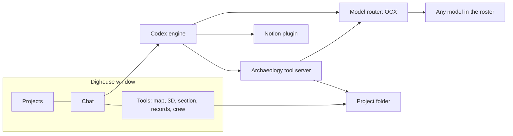

# Dighouse: an autonomous archaeology workbench built on the Codex harness

Dighouse is a free, open-source desktop app for finding archaeological sites in open data. It combines the Codex agent harness, the user's own model router, and a set of archaeology tools in one window. Agents do the searching on their own, check their own work at every stage, write down what they did, and stop for a person at the points where a human decision matters.

A dig house is the building where an excavation team lives, works and keeps its records. The app plays the same role for a search: it holds the projects, the crew and the notebook.

The idea comes from Pietro Miotti's November 2026 experiment, in which agents screened about 1,200 km² of NASA lidar overnight and flagged a Maya site. The site turned out to be already published. Finding candidates was cheap; checking them was the part that failed. Dighouse is designed around that check.

## What using it looks like

1. Download Dighouse and open it. It finds the Codex engine and, if OpenCodex (OCX) is running, shows every model in the OCX roster.
2. Start from Home. If you know the place, pick the area on a map and see which open lidar covers it. If you do not, ask the agent to help you choose: it compares open surveys with what is already recorded and suggests areas. Either way you end with a project: a region and a question.
3. Start a run. Agents download the data, strip the forest away, screen the terrain, verify what they flag, and search the literature.
4. Watch or leave. The map, the cross-sections and the records update as the agents work. You can steer the run at any time by typing.
5. Review. Each candidate arrives as a record with its evidence, the sources checked, and a status. Nothing is called new without your decision.

## How it is built



| Layer | What it is | Built or inherited |
|---|---|---|
| Models | OCX, or whatever models the user's Codex is set up with | Inherited |
| Harness | The Codex engine (`codex app-server`), running inside Dighouse | Inherited |
| Archaeology tools | A tool server for the data work, plus the panes that show it | Built |
| Projects and records | A folder per project, Markdown records, a mirror in Notion | Built |

The window shows one place at a time, chosen from the sidebar: Home, a chat, New project, Toolbox or Settings. Chats work with or without a project. Opening a project puts its workspace beside the chat, with a divider that drags, and the workspace has three tabs: Map, Records and Notes. The Toolbox is its own page: how a search works in six stages with the tools behind each, the workflows, the open data services, and other tools. Settings is a page in the window that explains the three parts Dighouse is made of (the AI model, the agent engine and the archaeology tools), the account the engine uses and where data goes. Home opens with a picture that drags between treetops and bare ground, and says plainly what a chat app cannot do.

The message box follows ChatGPT: one pill for the model and its thinking effort, which opens an effort slider with the searchable model list behind the model's name. It takes images, video, audio and other files. The chat shows the agent's plan as a checklist, each step it takes, helper agents, and folds long runs into one line.

In a project, a run strip stays across the top of the window. It shows how many tiles have been screened, how many known sites were found again, the number of candidates, and anything waiting for a person.

## Connecting to Codex and OCX

The Codex engine is open source under Apache 2.0, so Dighouse can include it or use the copy already installed. As of Codex 0.146.0 the engine provides, through its app-server:

- chats tied to a project folder, with resume, fork and rollback
- a model chosen per chat and per message
- steering and interrupting a running turn, and long-running goals
- image and audio input
- sub-agent activity
- skills, plugins, and sign-in to outside services such as Notion
- tools defined by the host app, which is how the Dighouse panes are driven

The app-server is marked experimental, so its interface can change between Codex versions.

OCX works by pointing Codex's model traffic at a local address and adding its model list to Codex's settings. Because Dighouse runs the same engine with the same settings, the full roster appears in its model picker with no extra setup. OCX also exposes local endpoints for direct requests (responses, chat completions, messages and a model list), which Dighouse uses for bulk image screening.

People without OCX use the models their Codex sign-in provides. OCX is optional.

Computer use, the built-in browser and scheduled automations belong to the Codex desktop app, so Dighouse does not get them from the engine.

## The archaeology tools

| Tool | What it does |
|---|---|
| Data finder | Lists open lidar and imagery covering an area, with licence terms |
| Fetch | Downloads data into the project and verifies it |
| Bare ground | Separates ground points from vegetation and builds a ground model |
| Relief | Renders the ground several ways: hillshade from multiple light angles, slope, local relief |
| Screen | Sends every tile to vision models with a written guide and collects verdicts |
| Section | Cuts a slice through the raw points at a chosen line |
| Modern check | Compares a flag against open maps and satellite imagery to rule out roads, quarries and farms |
| Prior art | Searches the literature, starting with every paper that used the same dataset |
| Ledger | Creates and updates candidate records |
| Report | Drafts a report for the relevant heritage authority |

The tool server also works in the ordinary Codex app, so searches can begin before the Dighouse window exists. Its first version is built and tested against real data in the [dighouse repository](https://github.com/chrissotraidis/dighouse). In that version the agent looks at each tile itself; bulk screening through the router comes later.

Starting data sources are [NASA G-LiHT](https://glihtdata.gsfc.nasa.gov/), [OpenTopography](https://portal.opentopography.org/datasets) and [USGS 3DEP](https://registry.opendata.aws/usgs-lidar/). Some OpenTopography collections are restricted for non-academic users, which the data finder reports.

In November 2026 OpenTopography republished the G-LiHT Yucatán transects as [reprocessed ground points and ground models](https://doi.org/10.5069/G9TH8JX9). Its description states that these surfaces underlie a catalog of 57,181 detected Maya structures (Britton 2026). Any search of those transects starts from that catalog as prior work.

## The autonomous loop

A run repeats these stages until the project area is covered, the budget is spent, or it reaches a point that needs a person.

| Stage | What the agents do | How the work is checked | Stops for a person |
|---|---|---|---|
| Plan | Read the project file and notes, choose the next area | A coverage map records what has been screened, so nothing is skipped or done twice | When the project question is unclear |
| Acquire | Find and download data | Files verified; coverage compared with the requested area; licence recorded | When data needs an account or has use limits |
| Prepare | Build the ground model and render relief | Tiles with too few ground points are marked unreadable, never "nothing found" | |
| Screen | Vision models review every tile | Published sites in the same area act as controls; the run reports how many it found again | When too few controls are found |
| Second look | A different model reviews each flag with more views | Two models must agree; the section must show the feature in ground points; modern features ruled out | |
| Prior art | Search and read the literature | Every source logged as read or could not open; the candidate stays unresolved until all are read | Always, before anything is called unrecorded |
| Record | Write the candidate record and push it to Notion | A record cannot be completed without relief, section and source log | |
| Report | Draft a report for the heritage authority | | Always; a person sends it |

Two rules apply throughout. The agents never say a site is new; they say how many sources were read and that none matched. Exact locations stay on the user's computer and go only to the heritage authority, because published coordinates invite looting.

The harness supplies the persistence: goals keep a run going across many turns, and the project notes let a run resume the next day.

## Projects and records

A project is a folder.

```
southern-campeche/
  PROJECT.md      the question, the area, the rules agents follow
  crew            which model does which job
  candidates/     one Markdown record per candidate
  notes/          a dated log the agents write as they work
  sources/        what was read and what could not be opened
  reports/        drafts for the authorities
  data/           lidar and rendered tiles
```

Markdown is the record of truth. It works offline, can be versioned, and can be shared as a folder. Notion is a mirror pushed from the Markdown through the Notion plugin: a project page, a candidates table and the daily notes. Locations are left out of the push by default.

A candidate moves through these statuses: flagged, ground feature confirmed, then one of modern, natural, already published, or no match in sources read, and finally reported.

## Crew and inference

Each job in a run has its own model from the roster.

| Job | Needs | Path to the model |
|---|---|---|
| Lead | Tool use, judgement | Codex engine |
| Tile screening | Image reading, low cost | Direct to the router, in bulk |
| Second look | Image reading, a different model from screening | Codex engine |
| Prior art | Tool use, long reading | Codex engine |
| Report writer | Writing | Codex engine |

Before a run starts, Dighouse tests each assigned model for image reading and tool use, because not every model in a roster can do both.

## Build order

1. The archaeology tool server, usable in the ordinary Codex app. The first version is built.
2. The project format, the Markdown records and the Notion push.
3. The Dighouse window with the Codex engine inside it. Existing open-source clients for the same engine are useful references: [CodexGui](https://github.com/wieslawsoltes/CodexGui), [codex-ui](https://github.com/sseymdoc/codex-ui), [CC Pocket](https://github.com/K9i-0/ccpocket) and [Agmente](https://github.com/rebornix/Agmente).
4. The crew, bulk screening and the unattended loop.

## Open decisions

- **Licence.** The repository uses Apache 2.0, matching the Codex engine, while it is private. This can change before it is made public.
- **Canopy in sections.** Datasets published as ground points only, such as the reprocessed Yucatán set, cannot show the forest above a feature. Those sections need NASA's full point clouds from the G-LiHT portal.
- **Packaging.** The geospatial libraries are large; the app needs to ship them so users install nothing else.
- **Bulk screening path.** OCX's direct endpoints exist on this setup, but no screening request has been sent through them yet.
- **Controls.** Published site locations are not open for every region, so some projects will run without controls.
- **Name.** Dighouse passed checks of domains, GitHub, package registries and the App Store. A trademark search has not been done.

