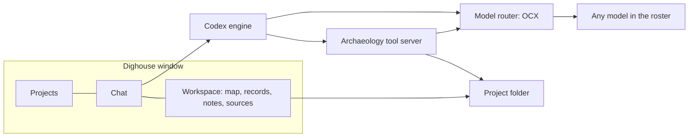

# Dighouse: an autonomous archaeology workbench built on the Codex harness

Dighouse is a free, open-source desktop app for finding archaeological sites in open data. It combines the Codex agent harness, the user's own model router, and a set of archaeology tools in one window. Agents do the searching on their own, check their own work at every stage, write down what they did, and stop for a person at the points where a human decision matters.

A dig house is the building where an excavation team lives, works and keeps its records. The app plays the same role for a search: it holds the projects, the crew and the notebook.

The idea comes from Pietro Miotti's November 2026 experiment, in which agents searched about 1,200 km² of NASA lidar overnight and marked a Maya site. The site turned out to be already published. Finding things was cheap; checking them was the part that failed. Dighouse is designed around that check.

## What using it looks like

1. Build Dighouse and open it (it is not a download yet). It finds the Codex engine and, if OpenCodex (OCX) is running, shows every model in the OCX roster.
2. Start from Home. If you know the place, pick the area on a map and see which open lidar covers it. If you do not, ask the agent to help you choose: it compares open surveys with what is already recorded and suggests areas. Either way you end with a project: a region and a question.
3. Start a run, a stage at a time or all at once with Find and report back. Agents download the data, take the trees away, look at the bare ground, check what they mark, and search what is published.
4. Watch or leave. The map, the slices and the records update as the agents work. You can steer the run at any time by typing.
5. Review. A whole search ends with a report a person can read in two minutes, and each find arrives as a record with its evidence, the sources checked, and a suggested decision. Nothing is called new, and the decision is yours.

## How it is built



| Layer | What it is | Built or inherited |
|---|---|---|
| Models | OCX, or whatever models the user's Codex is set up with | Inherited |
| Harness | The Codex engine (`codex app-server`), running inside Dighouse | Inherited |
| Archaeology tools | A tool server for the data work, plus the panes that show it | Built |
| Projects and records | A folder per project with Markdown records; a Notion mirror is planned | Built |

The window shows one place at a time, chosen from the sidebar: Home, a chat, New project, Toolbox or Settings. Chats work with or without a project. Opening a project puts its workspace beside the chat, with a divider that drags, and the workspace has five tabs: Map, Records, Notes, Sources and Data. The Toolbox is its own page: how a search works in six stages with the tools behind each, the workflows, the open data services, and other tools. Settings is a page in the window that explains the three parts Dighouse is made of (the AI model, the agent engine and the archaeology tools), the account the engine uses and where data goes. Home opens with a picture that drags between treetops and bare ground, and says plainly what a chat app cannot do. The default colours are the soil brown, tan and green of the icon, with other looks under Personalize. The Sources tab lists every source on the records and has a browser: a person can open a page the agent was refused and hand its text to the agent. A "What should I research?" workflow ranks regions by open lidar against what is on open record and proposes searches.

The message box follows ChatGPT: one pill for the model and its thinking effort, which opens the searchable model list with the effort slider above it. It takes images, video, audio and other files. The chat shows the agent's plan as a checklist, each step it takes, helper agents, and folds long runs into one line.

In a project, a run strip stays across the top of the window. It shows how many tiles have been looked at, how many known sites were found again, the number of finds, and anything waiting for a person. During a whole search it also shows the stage the agent is on and a Stop.

The app has its own pictures, drawn in SwiftUI: a trowel, a brush, a sieve, soil layers, a mound in section and a survey grid. They mark the stages and workflows, and a trowel scraping along a line of soil is the one sign that the agent is at work.

## Connecting to Codex and OCX

The Codex engine is open source under Apache 2.0, so Dighouse can include it or use a copy already installed. It starts the newest copy on the Mac, since providers refuse newer models to an older engine. As of Codex 0.167 the engine provides, through its app-server:

- chats tied to a project folder, with resume, fork and rollback
- a model chosen per chat and per message
- steering and interrupting a running turn, and long-running goals
- image and audio input
- sub-agent activity
- skills, plugins, and sign-in to outside services such as Notion
- tools defined by the host app, which is how the Dighouse panes are driven

The app-server is marked experimental, so its interface can change between Codex versions.

OCX works by pointing Codex's model traffic at a local address and adding its model list to Codex's settings. Because Dighouse runs the same engine with the same settings, the full roster appears in its model picker with no extra setup. OCX also exposes local endpoints for direct requests (responses, chat completions, messages and a model list). They are meant for bulk image screening, which is not built yet.

People without OCX use the models their Codex sign-in provides. OCX is optional.

Computer use, the built-in browser and scheduled automations belong to the Codex desktop app, so Dighouse does not get them from the engine.

## The archaeology tools

41 tools in one Model Context Protocol server (`src/dighouse`). The README lists them by stage.

| Stage | What the tools do |
|---|---|
| Choose where to look | Find a place, list open surveys and what covers an area, compare open lidar with sites already on record, list open archives and what is out of reach |
| Fetch | Download raw points from OpenTopography or USGS 3DEP, or a national ground model for England, the Netherlands or France, and build the bare ground |
| Look | Render the ground as a composite, hillshade, local relief or sky view; cut it into tiles and hand them out in batches |
| Look | Record a verdict for each tile and mark finds |
| Check | Cut a slice through the raw points, record a second opinion from a different model, check open maps for modern features and mapped sites, add known sites as controls |
| What is published | Search OpenAlex and Open Context, read pages and PDFs (including pages a person saved), and log every source |
| Records | Add evidence, suggest a decision, set a status the checks support, list what each find lacks, report the run, write the run summary and the search report, rebuild the research record, export finds as GeoJSON |

The tool server also works in the ordinary Codex app, or any harness that speaks MCP. The agent looks at each tile itself; looking at tiles in bulk through the router comes later.

The data comes from [OpenTopography](https://portal.opentopography.org/datasets), [USGS 3DEP](https://registry.opendata.aws/usgs-lidar/), the Environment Agency (England), AHN (the Netherlands), IGN LiDAR HD (France), Digitaal Vlaanderen (Flanders), Kartverket (Norway), the Estonian Land Board and swisstopo (Switzerland) for the ground; OpenStreetMap (through QLever, with Overpass as the fallback), Wikidata, Pleiades and the US National Register for recorded sites; and Open Context and OpenAlex for the literature. None needs an account. Some OpenTopography collections are restricted for non-academic users, which the data finder reports.

In November 2026 OpenTopography republished the G-LiHT Yucatán transects as [reprocessed ground points and ground models](https://doi.org/10.5069/G9TH8JX9). Its description states that these surfaces underlie a catalog of 57,181 detected Maya structures (Britton 2026). Any search of those transects starts from that catalog as prior work.

## The autonomous loop

A run repeats these stages until the project area is covered, the budget is spent, or it reaches a point that needs a person.

| Stage | What the agents do | How the work is checked | Stops for a person |
|---|---|---|---|
| Plan | Read the project file and notes, choose the next area | A coverage map records what has been looked at, so nothing is skipped or done twice | When the project question is unclear |
| Acquire | Find and download data | Files verified; coverage compared with the requested area; licence recorded | When data needs an account or has use limits |
| Prepare | Build the ground model and render relief | Tiles with too few ground points are marked unreadable, never "nothing found" | |
| Look | Vision models look at every tile | Published sites in the same area act as controls; the run reports how many it found again | When too few controls are found |
| Second opinion | A different model looks at each find | Two models must agree; the slice must show the feature in ground points; modern features ruled out | |
| What is published | Search and read the literature | Every source logged as read or could not open; the find stays unresolved until all are read | Always, before anything is called unrecorded |
| Record | Write the find's record (a Notion push is planned) | A record cannot be completed without relief, slice and source log | |
| Search report | Write what needs a person first, then what was asked, done, read and ruled out, in 400 words at most | Built only from the records, so it cannot say more than they do; no coordinates | Always: it ends with the decisions waiting |
| Report | Draft a report for the heritage authority | | Always; a person sends it |

Two rules apply throughout. The agents never say a site is new; they say how many sources were read and that none matched. Exact locations stay on the user's computer and go only to the heritage authority, because published coordinates invite looting.

The harness supplies the persistence: goals keep a run going across many turns, and the project notes let a run resume the next day.

## Projects and records

A project is a folder.

```
southern-campeche/
  RESEARCH.md     the research record, rebuilt from everything below
  PROJECT.md      the question and the rules agents follow
  METHODOLOGY.md  how the search and the record are kept
  candidates/     one Markdown record per find
  notes/          a dated log the agents write as they work, and run summaries
  sources/        what was read and what could not be opened
  reports/        the search report, and drafts for the authorities
  data/           lidar and rendered tiles (stays on this Mac)
  private/        locations and run state (stays on this Mac)
```

Markdown is the record of truth. It works offline, can be versioned, and can be shared as a folder. A project that is handed over travels without data/ and private/; its research record still says which ground was looked at and what it showed, so the next person carries on from it. A Notion mirror pushed from the Markdown (a project page, a finds table and the daily notes, with locations left out) is planned and waits on a decision.

A find moves through these statuses: marked, in the ground, then one of modern, natural, already published, or no match in sources read, and finally reported.

## Crew and inference

Each job in a run has its own model from the roster.

| Job | Needs | Path to the model |
|---|---|---|
| Lead | Tool use, judgement | Codex engine |
| Looking at tiles | Image reading, low cost | Direct to the router, in bulk |
| Second opinion | Image reading, a different model from the first look | Codex engine |
| What is published | Tool use, long reading | Codex engine |
| Report writer | Writing | Codex engine |

Not every model in a roster works, or works at every thinking effort. The app does not test them ahead of time: the model list says what each offers, and a model that fails says so in the chat, with a way to try again or pick another.

## Build order

1. The archaeology tool server, usable in the ordinary Codex app. Built.
2. The project format and the Markdown records. Built; the Notion push is not.
3. The Dighouse window with the Codex engine inside it. Built. Existing open-source clients for the same engine were useful references: [CodexGui](https://github.com/wieslawsoltes/CodexGui), [codex-ui](https://github.com/sseymdoc/codex-ui), [CC Pocket](https://github.com/K9i-0/ccpocket) and [Agmente](https://github.com/rebornix/Agmente).
4. The crew, looking at tiles in bulk and the unattended loop. A whole search now runs unattended from one button to a report, with the second opinion asked for by the app and the decisions left to the person; looking at tiles in bulk through the router is not built.

## Open decisions

- **Licence.** The repository uses Apache 2.0, matching the Codex engine, while it is private. This can change before it is made public.
- **Treetops in slices.** Datasets published as ground points only, such as the reprocessed Yucatán set, cannot show the forest above a feature. Those slices need NASA's full point clouds from the G-LiHT portal.
- **Packaging.** The app carries the Python tools and builds their environment with uv on first launch, so a person still needs Codex and uv installed. A notarized download waits on a decision.
- **Looking at tiles in bulk.** OCX's direct endpoints exist on this setup, but no such request has been sent through them yet.
- **Controls.** Published site locations are not open for every region, so some projects will run without controls.
- **Name.** Dighouse passed checks of domains, GitHub, package registries and the App Store. A trademark search has not been done.

What comes next, including a second field for open astronomy, is in [ROADMAP.md](ROADMAP.md).
